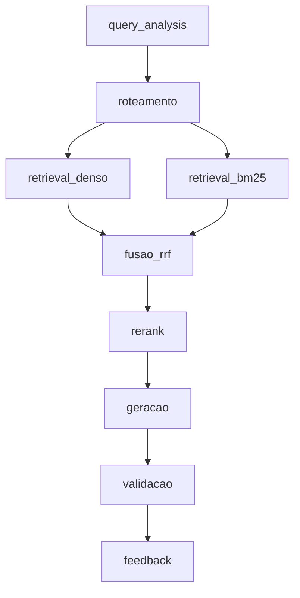

# Arquitetura — Grande Desafio RAG

## 1. Cenário escolhido

**Cenário 1 — Contratações Públicas do Estado do Rio de Janeiro**

Escolhemos o tema de Contratações Públicas por possuir grande quantidade de informações disponíveis e verificáveis em fontes oficiais, como o PNCP, facilitando tanto a construção do corpus quanto a validação das respostas do sistema. Além disso, a diversidade dos dados e tipos de consulta, envolvendo informações estruturadas, documentos e buscas textuais ou semânticas, torna o cenário adequado para testar uma abordagem de Adaptive RAG combinando filtros por metadados, busca lexical e busca vetorial.

---

## 2. Pipeline da solução

**O pipeline é composto pelos seguintes estágios:**

- query_analysis
- roteamento
- retrieval_denso
- retrieval_bm25
- fusao_rrf
- rerank
- geracao
- validacao
- feedback

### Diagrama do fluxo

## Stages

- `query_analysis`
- `roteamento`
- `retrieval_denso`
- `retrieval_bm25`
- `fusao_rrf`
- `rerank`
- `geracao`
- `validacao`
- `feedback`

## 3. Divisão de responsabilidades

Neste momento inicial do projeto, a divisão definitiva das responsabilidades entre os integrantes ainda está em discussão.

Durante esta etapa, o desenvolvimento está sendo realizado de forma **colaborativa**, com os integrantes trabalhando conjuntamente na definição da arquitetura, estrutura do projeto, corpus, pipeline de RAG e decisões técnicas.

A divisão dos módulos e responsabilidades individuais será formalizada conforme o projeto avançar e as necessidades de implementação forem melhor definidas.

### Responsabilidades atuais

- Definição conjunta da arquitetura da solução;
- Definição do corpus e das fontes de dados;
- Discussão das estratégias de recuperação;
- Desenvolvimento colaborativo dos módulos;
- Definição e validação das personas e perguntas de referência;
- Discussão e implementação do Adaptive RAG;
- Testes e avaliação da solução.

---

## 4. Coordenação da equipe

**Coordenador:** Renato Lemos

No momento, Renato Lemos assumiu a responsabilidade pela coordenação da equipe, auxiliando na organização das atividades, acompanhamento do desenvolvimento e alinhamento das decisões do grupo.

A coordenação poderá ser ajustada conforme a evolução do projeto e a definição formal das responsabilidades individuais.
