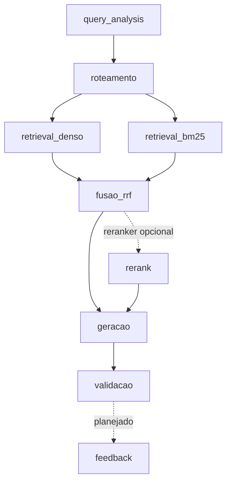

# Arquitetura — Grande Desafio RAG

## 1. Cenário escolhido

**Cenário 1 — Contratações Públicas do Estado do Rio de Janeiro**

Escolhemos o cenário de Contratações Públicas pela disponibilidade de dados verificáveis em fontes oficiais, principalmente o PNCP, e pela diversidade das informações envolvidas. O cenário permite testar uma arquitetura de **Adaptive RAG** combinando análise da consulta, filtros por metadados, busca lexical, busca vetorial, guardrails e validação das respostas.

---

## 2. Pipeline da solução

**O pipeline implementado é composto pelos seguintes estágios:**

- `query_analysis`
- `roteamento`
- `retrieval_denso`
- `retrieval_bm25`
- `fusao_rrf`
- `geracao`
- `validacao`

O estágio `rerank` é opcional e está disponível apenas como ponto de extensão. O estágio `feedback` está planejado, mas ainda não foi integrado ao pipeline.

### Diagrama do fluxo

### Stages

- `query_analysis`: interpreta a pergunta e extrai filtros de ano, valor e órgão. Os filtros foram ajustados para não eliminar chunks que não possuem o campo correspondente e o pipeline refaz a busca sem filtros quando eles zeram o resultado.
- `roteamento`: identifica as bases adequadas para responder à consulta e trata perguntas fora do escopo.
- `retrieval_denso`: realiza recuperação semântica por embeddings.
- `retrieval_bm25`: realiza recuperação lexical por BM25.
- `fusao_rrf`: combina os resultados das buscas densa e lexical usando Reciprocal Rank Fusion.
- `rerank`: está previsto e o `retrieve` aceita um reranker plugável, mas ainda não há modelo ativo no pipeline oficial.
- `geracao`: gera a resposta somente a partir das evidências recuperadas, com guardrails e política de sensibilidade.
- `validacao`: valida a saída do LLM, trata JSON inválido, remove citações inexistentes e mascara dados pessoais quando necessário.
- `feedback`: previsto na arquitetura e na observabilidade, mas ainda não integrado ao fluxo principal.

### Estado atual

Já estão implementados:

- Adaptive RAG com roteamento por tipo de evidência;
- recuperação híbrida com busca densa + BM25 + RRF;
- filtros por metadados com fallback quando a filtragem retorna vazio;
- guardrails para perguntas fora do escopo e ausência de evidência;
- política de sensibilidade e mascaramento de dados pessoais;
- validação da resposta gerada;
- observabilidade estruturada por `run_id`, `query_id`, stage, latência e uso de tokens;
- coleta e versionamento do corpus por manifesto;
- preparação de documentos, OCR, embeddings e indexação;
- API FastAPI com `GET /health` e `POST /api/v1/query`;
- CORS configurado para desenvolvimento local e para a origem `https://etuarda.github.io`;
- demonstração do frontend publicada em [https://etuarda.github.io/frontendRAG/](https://etuarda.github.io/frontendRAG/), ainda pendente de integração completa com a API;
- suporte a certificados HTTPS com `certifi` sem desabilitar validação SSL;
- golden set e estrutura de avaliação automatizada;
- 379 testes automatizados passando na verificação realizada em 2026-09-28.

### Corpus e índice

As bases oficiais definidas no manifesto são:

- `contratos_estruturado`;
- `editais_normativo`;
- `atas_conversacional`;
- `pca_agregado`.

A coleta das atas foi corrigida para utilizar o CNPJ oficial do Estado do Rio de Janeiro (`42498600000171`). O inventário corrigido vigente, registrado em `data/inventory/v1.json` e resumido em `CORPUS_INVENTORY.md`, contém **20 atas**, com os respectivos metadados e listagens de arquivos. O arquivo `data/inventory/v2.json` registra uma coleta anterior à correção e não representa o corpus vigente.

O índice utilizado anteriormente pela equipe possui **3.130 chunks**:

- 40 chunks de atas;
- 160 chunks de contratos;
- 843 chunks de editais;
- 2.087 chunks do PCA.

Esse índice ainda contém as atas anteriores à correção da coleta. O artefato versionado em `data/embeddings/embedding_report.json` pertence a outra execução e registra 516 chunks processados, com 447 embeddings gerados. Por isso, após consolidar o corpus corrigido, é necessário executar novamente o `prepare`, gerar embeddings e reconstruir um índice oficial único antes da avaliação final.

---

## 3. Divisão de responsabilidades

As tarefas são distribuídas entre os integrantes a cada encontro conforme as necessidades do projeto, dependências entre módulos e pendências encontradas nas revisões. A equipe não mantém uma divisão fixa por pessoa.

### Como as tarefas são organizadas

- **A cada encontro**, a equipe revisa o estado do projeto e distribui as próximas atividades.
- **As dependências entre módulos** são consideradas para evitar trabalhos conflitantes, principalmente entre coleta, indexação, análise de consulta e avaliação.
- **As revisões** geram novos ajustes e tarefas para os encontros seguintes.
- **O registro individual das contribuições** fica em `acompanhamento/ACOMPANHAMENTO_*.md`.

### Frentes atuais

- Extração e atualização do corpus oficial.
- Ajustes de `query_analysis` e reconstrução do índice.
- Avaliação com o golden set.
- API e integração entre backend e frontend.
- Desenvolvimento do frontend.

### Pendências em aberto

- Reconstruir o corpus normalizado e o índice com as atas corrigidas do Estado do Rio de Janeiro.
- Gerar novamente os embeddings após a consolidação do corpus oficial.
- Rodar o golden set completo com o pipeline e o índice definitivos.
- Integrar um modelo de `rerank` quando estiver disponível.
- Implementar o estágio de `feedback` no fluxo principal.
- Finalizar a integração do frontend com a API e incorporar o frontend ao repositório principal.
- Obter a base sintética de e-mails de compras fornecida pelo desafio.
- Validar/corrigir o comportamento de `update --dry-run` quando existe `data/inventory/vN.json` sem a pasta correspondente em `data/raw/vN/`.
- Garantir que qualquer diretório local usado para armazenar índices esteja coberto pelo `.gitignore`; atualmente, o diretório previsto e ignorado é `index/`.

---

## 4. Coordenação da equipe

**Coordenador:** Renato Lemos

Renato Lemos coordena a equipe, acompanha o andamento do projeto, apoia a organização e distribuição das tarefas e participa das decisões técnicas e do desenvolvimento.

A coordenação pode ser ajustada ao longo das sprints conforme decisão da equipe.
