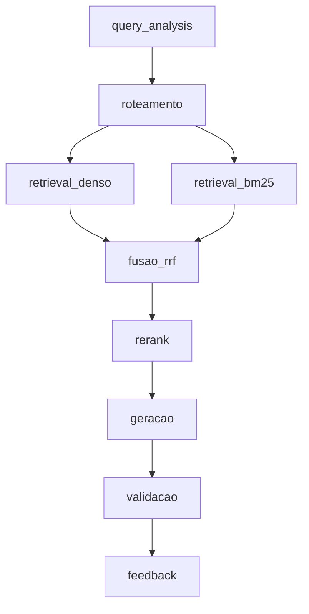

# Arquitetura — Grande Desafio RAG

## 1. Cenário escolhido

**Cenário 1 — Contratações Públicas do Estado do Rio de Janeiro**

Escolhemos o tema de Contratações Públicas por possuir grande quantidade de informações disponíveis e verificáveis em fontes oficiais, como o PNCP, facilitando tanto a construção do corpus quanto a validação das respostas do sistema. Além disso, a diversidade dos dados e tipos de consulta, envolvendo informações estruturadas, documentos e buscas textuais ou semânticas, torna o cenário adequado para testar uma abordagem de Adaptive RAG combinando filtros por metadados, busca lexical e busca vetorial.

---

## 2. Pipeline da solução

**O pipeline é composto pelos seguintes estágios:**

- query_analysis
- roteamento
- retrieval_denso
- retrieval_bm25
- fusao_rrf
- rerank
- geracao
- validacao
- feedback

### Diagrama do fluxo

## Stages

- `query_analysis`
- `roteamento`
- `retrieval_denso`
- `retrieval_bm25`
- `fusao_rrf`
- `rerank`
- `geracao`
- `validacao`
- `feedback`

## 3. Divisão de responsabilidades

As tarefas são distribuídas entre os integrantes a cada encontro, de acordo com as necessidades do projeto naquele momento e com o que surge nas revisões do trabalho já feito. Por isso, a equipe não mantém uma divisão fixa por pessoa: quem cuida de cada módulo pode mudar de um encontro para outro.

### Como as tarefas são organizadas

- **A cada encontro**, a equipe verifica o que falta em relação aos entregáveis do desafio e combina quem assume cada pendência, levando em conta a familiaridade de cada um com os módulos e a carga de trabalho.
- **As revisões** ajudam a apontar ajustes e novas tarefas, que entram na distribuição seguinte.
- **O registro do que cada integrante fez** fica no próprio arquivo de acompanhamento (`acompanhamento/ACOMPANHAMENTO_*.md`), atualizado a cada encontro.

### Pendências em aberto

- Declarar as bases `pca_agregado` e `atas_conversacional` no `corpus_manifest.yaml` e coletá-las quando a API do PNCP estabilizar (ver `CORPUS_INVENTORY.md`).
- Fazer `src/retrieve.py` consultar todas as bases de uma natureza, e não só uma.
- Definir qual `CORPUS_INVENTORY.md` é o oficial (raiz ou `data/`).
- Obter a base sintética de e-mails de compras fornecida pelo desafio.

---

## 4. Coordenação da equipe

**Coordenador:** Renato Lemos

Renato Lemos coordena a equipe: acompanha o andamento do projeto, ajuda a organizar e distribuir as tarefas a cada encontro e apoia o alinhamento das decisões do grupo, participando também do desenvolvimento.

A coordenação pode ser ajustada ao longo das sprints, conforme a equipe decidir.
