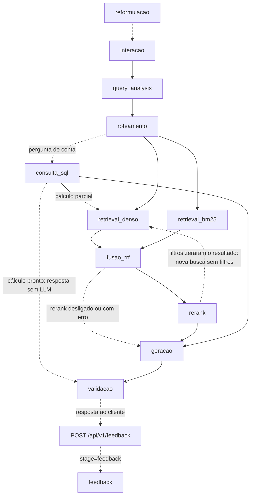

# Arquitetura — Grande Desafio RAG

## 1. Cenário escolhido

**Cenário 1 — Contratações Públicas do Estado do Rio de Janeiro**

Escolhemos o cenário de Contratações Públicas pela disponibilidade de dados verificáveis em fontes oficiais, principalmente o PNCP, e pela diversidade das informações envolvidas. O cenário permite testar uma arquitetura de **Adaptive RAG** combinando análise da consulta, filtros por metadados, busca lexical, busca vetorial, consulta estruturada, rerank, guardrails e validação das respostas.

---

## 2. Pipeline da solução

**O pipeline implementado é composto pelos seguintes estágios:**

- `reformulacao` (só quando o cliente envia `historico` e a pergunta parece continuação)
- `interacao`
- `query_analysis`
- `roteamento`
- `consulta_sql` (perguntas de conta sobre a base estruturada ou a agregada)
- `retrieval_denso`
- `retrieval_bm25`
- `fusao_rrf`
- `rerank`
- `geracao`
- `validacao`

Quando o resultado SQL já responde a pergunta inteira (cálculo pronto), a busca vetorial e lexical é pulada e a resposta sai direto do SQL, sem chamar o LLM. Ao fim, `resumo_consulta` registra o que foi tentado e o que retornou em cada caminho (SQL e vetorial).

O estágio `feedback` roda fora do pipeline de resposta (é acionado por `POST /api/v1/feedback`, depois que o cliente já recebeu a resposta), mas já está integrado à API e à observabilidade.

### Diagrama do fluxo

### Stages

- `requisicao_inicio`/`requisicao_fim`: envelope do handler API, com resultado HTTP, resposta pública preparada e estado da persistência; `persistencia_historico` registra a tentativa de salvar a consulta. O envelope fecha mesmo em erro, sem depender de logging não estruturado.
- `pipeline_inicio`/`pipeline_fim`: envelope do processamento, com tempo monotônico, versão/contexto de execução e resposta final. Etapas opcionais puladas e fallbacks ficam explícitos; os eventos trazem `extra.schema_version=2`, origem, sequência e resultado normalizado. O trace não soma durações sobrepostas e diferencia fechamento, erro e execução incompleta. Detalhes e limites em [docs/OBSERVABILIDADE.md](docs/OBSERVABILIDADE.md).
- `reformulacao`: o backend não guarda memória entre as perguntas; quem dá o contexto é o cliente, que reenvia as últimas trocas em `historico` no `POST /api/v1/query`. Quando a pergunta parece continuação ("considerando os mesmos contratos…", "E em 2024?"), um filtro determinístico a separa das que já se sustentam sozinhas (essas não chamam o modelo) e o LLM a reescreve usando só as 3 trocas mais recentes, com dado pessoal mascarado e o histórico tratado como dado, não como instrução. A pergunta reescrita substitui a original em todas as etapas seguintes, então os guardrails valem sobre o que de fato é consultado; a resposta devolve o texto digitado em `query` e a reescrita em `pergunta_reformulada`. Continuação que só troca o ano ("E em 2025?") é reescrita por regra, sem o modelo. Se o modelo falha ou devolve saída fora do formato, a pergunta segue com as anteriores anexadas (até a última que se sustenta sozinha), em vez de perder o contexto. Desligável com `REFORMULACAO_MODE=regras`. Ver [src/reformulacao.py](src/reformulacao.py).
- `interacao`: decide se a mensagem é conversa (saudação, agradecimento, pedido de ajuda, apresentação) ou consulta ao acervo ([src/conversation.py](src/conversation.py)). Conversa é respondida sem consultar o acervo; consulta segue para a `query_analysis`. Tem etapa própria no log para que mensagens de cortesia não apareçam como análise de consulta.
- `query_analysis`: interpreta a pergunta e extrai filtros de ano (incluindo período `ano`/`ano_final`), valor, órgão, esfera, modalidade, métrica (contagem/soma/média/mediana), agrupamento e qual campo de data usar (assinatura, publicação, resultado ou PCA). O órgão é reconhecido também em minúsculas e por sigla (DPE, SEEDUC etc.) e conferido no catálogo de órgãos do corpus ([data/config/orgaos_corpus.json](data/config/orgaos_corpus.json)); "Prefeitura (Municipal) de X" e "Prefeitura do Rio" viram o nome do órgão no PNCP, "MUNICIPIO DE X" ("PREFEITURA MUNICIPAL DE X" é o nome da unidade); citações de norma ("Lei federal 14.133", "Lei do Pregão") não viram esfera nem modalidade. Também viram filtro: o CNPJ citado, com ou sem pontuação (sem confundir com o começo de um número de controle do PNCP); o município citado sozinho ("contratos em Volta Redonda"), conferido na lista de municípios do catálogo, sem tratar como cidade o "Rio de Janeiro" de "órgãos estaduais do Rio de Janeiro"; e o fornecedor pelo nome ("empresa Cristália"), exigindo uma palavra-gatilho antes ou um nome de duas palavras, e sem escolher quando o nome casa com mais de um fornecedor. A extração de período foi corrigida para não confundir valores monetários ("acima de 2000 reais") com ano. Todos os filtros são marcados como opcionais, para não eliminar chunks que não possuem o campo correspondente, e o pipeline refaz a busca sem filtros quando eles zeram o resultado.
- `roteamento`: identifica as bases adequadas para responder à consulta e trata perguntas fora do escopo; quando recusa, já infere um motivo (dados bancários, credenciais vazadas, juízo de legalidade, fora de escopo, sem evidência) a partir de pistas na justificativa.
- `retrieval_denso`: realiza recuperação semântica por embeddings.
- `retrieval_bm25`: realiza recuperação lexical por BM25.
- `fusao_rrf`: combina os resultados das buscas densa e lexical usando Reciprocal Rank Fusion.
- `rerank`: reordena os candidatos da fusão com um cross-encoder local (`cross-encoder/mmarco-mMiniLMv2-L12-H384-v1`, multilíngue, via `sentence-transformers`), controlado por `RERANK_ENABLED` e `RERANK_CANDIDATES`. Os campos de conteúdo (objeto/título/descrição) são reordenados antes do rerank para caber na janela de 512 tokens do modelo nos chunks de base estruturada em JSON. Medido em [docs/ABLACAO_RERANK.md](docs/ABLACAO_RERANK.md) no corpus v6, com 47 perguntas (34 parafraseadas + 13 de identificador: número de contrato, CNPJ, pregão, UASG etc.): o rerank sobre o RRF leva o hit@3 de 0,64 para 0,83 no conjunto completo e de 0,46 para 0,85 nas perguntas de identificador — por isso o padrão é RRF + rerank@10 (`RERANK_CANDIDATES=10`). A busca densa sozinha só acha 31% dos identificadores, e o BM25 sozinho erra as perguntas parafraseadas; por isso a fusão híbrida com rerank se mantém, em vez de usar só a busca densa. Ver [src/rerank.py](src/rerank.py).
- `consulta_sql`: para perguntas de conta (ranking, contagem, média/mediana, agrupamento, evolução mensal, listagem com assunto) sobre a base de contratos ou a agregada, consulta a base relacional (Postgres ou SQLite local, conforme `DATABASE_URL`) com SQL fixo (nunca gerado pelo LLM) — na tabela de contratações ou em `pca_planos`, quando a pergunta é sobre o PCA — e injeta o resultado, marcado como `doc_type=sql`, na frente dos chunks recuperados. A base do projeto é o Postgres no Neon; o SQLite versionado em `data/structured/` serve a quem não tem a connection string, aos testes e às avaliações. Regras da consulta:
  - esfera e modalidade vêm do `query_analysis`; o órgão é casado com os nomes do banco (sem aceitar um órgão "federal" ou "regional" que a pergunta não pediu, e com "prefeitura" valendo também como "município");
  - "contratos" conta só contratos assinados, pela data de assinatura (ou de publicação, se a pergunta pedir); "contratações" e "compras" misturam compras e contratos, e a contratação que tem os dois registros conta uma vez (coluna `numero_controle_compra`);
  - valores abaixo de R$ 1,00 (R$ 0,00 e R$ 0,01 simbólicos do PNCP) ficam fora de média, mediana, evolução e ranking, e são contados à parte;
  - "tecnologia" é lida como TI (tecnologia da informação, informática, software, TIC);
  - quando nenhum registro informa a modalidade, o resultado diz que não é possível saber; quando a pergunta cita uma lei, o resultado avisa que a norma não é filtro (os contratos assinados não trazem o amparo legal);
  - o CNPJ citado filtra pelo CNPJ do órgão ou do fornecedor (`fornecedor_cnpj`, schema 7); se os dígitos verificadores não conferem, o cabeçalho do resultado avisa;
  - cada consulta grava um **recorte**: execução completa ou parcial (com os filtros relaxados), tipo de resultado (registros, soma zero, sem correspondência, cálculo indisponível), completude dos campos usados e a cobertura (amostra do snapshot, com o total de registros). A confiança da resposta vem desse recorte (ver `geracao`).

  Ver [src/structured_query.py](src/structured_query.py) e [src/structured_db.py](src/structured_db.py).
- `geracao`: gera a resposta somente a partir das evidências recuperadas, com guardrails e política de sensibilidade. O orçamento de contexto é controlado por `GENERATION_CONTEXT_CHARS` (3.500 caracteres na janela curta do endpoint da turma, 12.000 com `LLM_PROVIDER_MODE=openrouter`) e `GENERATION_CHUNK_CHARS` (900 por trecho). Cada chamada ao LLM usa `GENERATION_TIMEOUT` (180 s) e `GENERATION_MAX_RETRIES` (1 tentativa extra); no modo `auto`, padrão, se o endpoint da turma falha a geração tenta o OpenRouter (`openrouter/free`) (ver [config.py](config.py) e [llm_ecoa.py](llm_ecoa.py)). A confiança de respostas com SQL vem do recorte da consulta: um zero de execução completa sustenta "não há registros" na amostra (confiança alta), execução parcial limita a média e cálculo indisponível a baixa; o escopo (amostra, não o universo do Estado) vai em `avisos` e, quando nada foi encontrado, também numa ressalva no texto da resposta.
- `validacao`: valida a saída do LLM, trata JSON inválido, remove citações inexistentes e mascara dados pessoais quando necessário. Também converte recusas indevidas: quando o roteador já colocou a pergunta no escopo e o LLM escreveu uma resposta com evidência parcial mas ainda assim marcou recusa por "fora de escopo" ou "sem evidência", a recusa vira resposta com confiança baixa, e a conversão fica registrada como `recusa_convertida` no log (`_converter_recusa_indevida` em [src/generate.py](src/generate.py)). Recusas de guardrail (dados bancários, credenciais, juízo de legalidade) nunca são convertidas.
- `feedback`: não roda dentro de `responder`, e sim quando o usuário avalia uma resposta já entregue. `POST /api/v1/feedback` associa a avaliação (`positivo`/`negativo` + comentário opcional) ao `query_id` da consulta original (404 se ele não existir) e grava o evento no log com esse mesmo `run_id`, amarrando-o aos demais stages da pergunta. Persistência e histórico em [src/history_store.py](src/history_store.py).

### Estado atual

Já estão implementados:

- Adaptive RAG com roteamento por tipo de evidência;
- recuperação híbrida com busca densa + BM25 + RRF + rerank por cross-encoder;
- consulta a base estruturada em SQL (Postgres/SQLite) para perguntas sobre contratos;
- filtros por metadados com fallback quando a filtragem retorna vazio;
- guardrails para perguntas fora do escopo e ausência de evidência, com motivo de recusa inferido;
- política de sensibilidade e mascaramento de dados pessoais;
- validação da resposta gerada;
- observabilidade estruturada por `run_id`, `query_id`, `session_id`, origem, sequência e outcome; envelopes API/pipeline com tempo monotônico, persistência do histórico, metadados de versão e resumo SQL/vetorial que distingue tentativa de retorno de evidências (`resumo_consulta`);
- coleta e versionamento do corpus por manifesto (atualmente na versão v6);
- preparação de documentos, OCR, embeddings e indexação;
- API FastAPI com `GET /health`, `POST /api/v1/query`, `POST /api/v1/feedback`, `GET /api/v1/history`, `GET /api/v1/trace/{query_id}` e `GET /api/v1/sessions/{session_id}/trace` (caminho da pergunta e da conversa, [src/trace.py](src/trace.py)), além do catálogo (`GET /api/v1/explore/contratacoes`, `/documentos`, `/orgaos`, `/fontes`) e de `GET /api/v1/project/summary`;
- feedback do usuário e histórico de consultas persistidos em SQLite local ([src/history_store.py](src/history_store.py)), com textos mascarados, expurgo após `HISTORY_RETENTION_DAYS` dias e a resposta completa comprimida com zlib (o campo só é lido inteiro, nunca pesquisado);
- histórico e trace com dois personas: `X-API-Key` igual a `RAG_API_KEY` (quem opera a demo) vê tudo; o header `X-Session-Id` vê só a própria conversa; sem nenhum dos dois, `401`. `HISTORY_PUBLIC=true` abre o histórico geral para uma demo (desligado por padrão);
- CORS configurado para desenvolvimento local e para a origem `https://etuarda.github.io`;
- frontend em repositório separado, publicado em [https://etuarda.github.io/frontendRAG/](https://etuarda.github.io/frontendRAG/): consome consulta, feedback, trace da pergunta e da conversa, catálogo e resumo do projeto, e mostra os `avisos` da resposta. Na demo, o backend roda na máquina de quem apresenta e fica público por um túnel ngrok no domínio fixo gratuito (README, seção 9.1); o site ainda precisa ser publicado apontando para ele;
- suporte a certificados HTTPS com `certifi` sem desabilitar validação SSL;
- golden set atual com 29 casos (`E1`–`E3`, dos e-mails sintéticos, entraram em 14/10) e critérios de conteúdo (radicais, teto de confiança, negação), mais um conjunto de busca com 47 perguntas e a ablação do rerank. A rodada auditada de 2026-10-14 (`20261014T191537Z`, commit `0e4cd73`) usou o snapshot de 26 casos anterior a `E1`–`E3`: 13/26 (50%), roteamento 25/26, recusa 24/26, conteúdo 14/24 e citação correta 22/24. Houve dois erros do provedor, não validáveis como conteúdo. Resultado pontual, não medida permanente; comparação com 09/10 é parcial. Detalhes e análise individual em [docs/registro_execucao_v6.md](docs/registro_execucao_v6.md#auditoria-documental-do-golden-set-execução-20261014t191537z-2026-10-15);
- scripts de instalação (`scripts/setup.ps1`/`setup.sh`) e de download dos modelos com hash conferido (`scripts/models.ps1`/`models.sh`);
- 1.653 testes automatizados passando na verificação realizada em 2026-10-14.

### Corpus e índice

As bases oficiais da v6 são:

- `contratos_estruturado`;
- `editais_normativo`;
- `atas_conversacional`;
- `pca_agregado`;

mais o suplemento sintético `emails_sinteticos` (25 conversas geradas pelo tutor, 20 públicas e 5 restritas; [docs/emails_sinteticos.md](docs/emails_sinteticos.md)).

O inventário vigente é a versão v6, registrada em `data/inventory/v6.json` e resumida em `CORPUS_INVENTORY.md` e `docs/registro_execucao_v6.md`: **1.400 arquivos** no total (contratos_estruturado 625, editais_normativo 13, atas_conversacional 376, pca_agregado 386), distribuídos por esfera em municipal 804, federal 513 e estadual 83, com limite de até 5 documentos por órgão/base. O manifesto da v6 está arquivado byte a byte em [archive/corpus_manifest_v6.yaml](archive/corpus_manifest_v6.yaml); o `corpus_manifest.yaml` passou a descrever o censo **v7** (contratos e publicações de 2025), que está em construção e só substitui a v6 depois da regressão e da re-auditoria do golden set ([docs/PLANO_POSSIVEL_CORPUS_V7.md](docs/PLANO_POSSIVEL_CORPUS_V7.md)). O histórico de reconstrução do inventário entre as versões está em `data/inventory/DIFF_v2_v3.md`, `DIFF_v3_v4.md`, `DIFF_v4_v5.md` e `DIFF_v5_v6.md`.

O índice oficial vigente ([index/manifest.json](index/manifest.json)) usa embeddings `Qwen3-Embedding-0.6B.Q8_0` (dimensão 1024) em índice FAISS (`index/*/vectors.faiss`), gerados a partir de `data/normalized/v6/documents.jsonl`. Depois da recuperação OCR de 2026-10-07 ([src/qualidade_corpus.py](src/qualidade_corpus.py), relatório em [data/inventory/qualidade_v6.json](data/inventory/qualidade_v6.json)), ele tem **5.090 vetores** da v6, mais os 25 das conversas sintéticas (**5.115 no total**), sem trechos ilegíveis:

- 625 chunks de `contratos_estruturado`;
- 1.557 chunks de `editais_normativo`;
- 1.997 chunks de `atas_conversacional`;
- 911 chunks de `pca_agregado`.

Foram preservados os vetores dos textos inalterados. A recuperação produziu 305 novos registros vetoriais a partir de 283 textos distintos, com o mesmo checkpoint e configuração do índice. Os 826 chunks anteriormente excluídos foram substituídos por texto legível e nova segmentação: 52 páginas de 3 atas passaram pelo Tesseract (`por`), e os códigos `/U0044` de 7 páginas dos Decretos 48.816 e 48.760 foram decodificados, inclusive nos cabeçalhos de páginas majoritariamente legíveis. Números de página permanecem junto do parágrafo ou seção, sem virar chunks isolados. O manifesto histórico da coleta foi recuperado por hash, sem alterar o manifesto atual ou os arquivos brutos. Detalhes em [eval/runs/v6-ocr-recovery.json](eval/runs/v6-ocr-recovery.json). SQLite e Neon foram remontados em 2026-10-09 (schema 7, com `fornecedor_cnpj`) e comparados linha a linha: `contratacoes` tem 810 linhas (455 contratos assinados e 355 compras publicadas, 185 delas vindas da base agregada) e `pca_planos`, 1.

**Limitações conhecidas da v6:**
- os indicadores do PCA (`pca_agregado`) estão praticamente ausentes do corpus coletado (só um PCA confirmado, da Secretaria de Saúde estadual);
- 452 dos 455 contratos assinados não têm `modalidade`: o PNCP não traz modalidade em contrato assinado. Todo contrato traz o número da compra de origem, mas só 9 delas estão no corpus; nesses pares a contratação conta uma vez, pela compra, que traz a modalidade. Preencher os outros exige coletar a compra de cada contrato (`numeroControlePncpCompra`), o que o censo v7 prevê. Das 355 compras publicadas, só 1 informa o fornecedor (cobertura de cada campo em [docs/QUALIDADE_DOS_DADOS.md](docs/QUALIDADE_DOS_DADOS.md));
- as normas têm início de vigência (`extras.data_vigencia_inicio`, declarado no manifesto ou vindo da publicação da compra no PNCP), mas não fim: nenhuma norma do corpus foi revogada. `data_vigencia` continua vazio nelas, porque no projeto ele é o fim da vigência ("vigente até"). Os textos são compilações atuais: a vigência histórica de cada dispositivo não foi verificada;
- há só 1 registro de "ambulância tipo D" (valor R$ 0,00), insuficiente para perguntas de mediana ou comparação entre esferas;
- 21 contratos têm valor R$ 0,00, 6 têm R$ 0,01 e 15 compras têm valor abaixo de R$ 1,00 (valores simbólicos, marcados com `extras.valor_simbolico`); a `consulta_sql` os deixa fora das contas de valor, e o prompt avisa que esse valor não é o custo real;
- o amparo legal só vem nas compras publicadas: nos contratos assinados ele é nulo, então não dá para contar contratos por lei.

Os diretórios `index/`, `data/normalized/`, `data/structured/` e `data/embeddings/` (os vetores ativos em `2026-10-07_21-18-41_ocr-recovery/` e a geração original em `2026-09-30_12-08-51/`) estão no `.gitignore`, mas são versionados via `git add -f` (forçado), de propósito, para que o time compartilhe o índice e o corpus processado sem reprocessar tudo localmente. Os inventários `data/inventory/*.json` são versionados normalmente, e os dois ZIPs da v6 em `atas-zip/` entram por exceção explícita no `.gitignore`. O `-text` do `.gitattributes` nesses caminhos preserva os bytes exatos (sem conversão CRLF/LF), porque os hashes de proveniência dependem deles. `data/app_state/` (onde fica o histórico de perguntas dos usuários, `src/history_store.py`) **não** está nessa lista e permanece fora do Git. A geração do corpus normalizado depende de OCR local (Tesseract + pacote de idioma português) instalado na máquina de quem roda o `prepare`.

---

## 3. Divisão de responsabilidades

As tarefas são distribuídas entre os integrantes a cada encontro conforme as necessidades do projeto, dependências entre módulos e pendências encontradas nas revisões. A equipe não mantém uma divisão fixa por pessoa.

### Como as tarefas são organizadas

- **A cada encontro**, a equipe revisa o estado do projeto e distribui as próximas atividades.
- **As dependências entre módulos** são consideradas para evitar trabalhos conflitantes, principalmente entre coleta, indexação, análise de consulta e avaliação.
- **As revisões** geram novos ajustes e tarefas para os encontros seguintes.
- **O registro individual das contribuições** fica em `acompanhamento/ACOMPANHAMENTO_*.md`.

### Frentes atuais

- Preparação do Demo Day (23/10): publicação do site, roteiro e ensaio.
- Avaliação: a execução de 2026-10-14 foi auditada sobre o snapshot de 26 casos do commit `0e4cd73` (13/26); o Golden Set atual tem 29 casos, então ainda é necessária uma execução completa do snapshot vigente antes de tomar o resultado como medida atual.
- Corpus v7 (censo de 2025), em construção; a v6 segue como base ativa.

### Pendências em aberto

Situação conferida em 2026-10-15, após auditoria documental da execução do Golden Set de 2026-10-14.

- **Reexecutar o Golden Set vigente (29 casos).** A rodada auditada em `docs/registro_execucao_v6.md` foi executada sobre o commit `0e4cd73`, cujo Golden Set continha 26 casos; `E1`–`E3` foram adicionados depois. Medir o snapshot atual com configuração e commit registrados e guardar os artefatos completos.
- **F1 (comparação sem dados suficientes):** nesta execução, a rota obtida foi somente `estruturada` (esperavam-se também `agregada` e `normativa`), o SQL apresentou 1 registro municipal de R$ 0,00, a resposta não declarou a insuficiência exigida e a confiança `media` excedeu o teto `baixa`. O resultado sustenta falha observável de roteamento e geração; não demonstra, por si só, ausência do dado no corpus.
- **P4.1/P4.2, P6.2/P6.3 e I2:** a execução mostrou, respectivamente, omissão de registros obrigatórios, conclusão de predominância sem suporte suficiente, afirmação imprecisa sobre disponibilidade de fornecedor, falta de referência normativa exigida pelo caso e omissão do identificador da ata. As etapas internas precisam ser confirmadas com trace/SQL antes de atribuir causa específica.
- **P2.3 e P3.2:** conteúdo reprovado apesar de respostas que podem satisfazer parte da intenção em linguagem natural; revisar os casos contra os critérios lexicais e as condições do enunciado. Não concluir que é erro do avaliador sem revisão manual dos documentos/fontes da execução.
- **Erros de infraestrutura em A1/A2:** obter os registros técnicos do provedor para diagnosticar as duas falhas; os artefatos disponíveis só apresentam a mensagem genérica de erro de geração.
- **Perguntas do golden set que dependem da anterior** (P1.3, P4.2 e P4.3): avaliar como conversa, enviando `historico`, ou reescrever. Incluir casos de atas e de identificador (CNPJ, número de controle).
- **Publicar o site apontando para o backend:** o site publicado (09/10) tem as telas de trace, mas foi gerado com o `VITE_API_BASE_URL` vazio. Falta enviar o header `ngrok-skip-browser-warning` nas chamadas, configurar a variável com o domínio do túnel e publicar. Os repositórios `Etuarda/frontendRAG` (com as telas de trace) e `sevenRevy/frontendRAG` (com os dois personas, `check:backend` e o botão do NEXO) divergem, e a branch `feat/melhorias-trace` ainda não entrou na `main` da Eduarda.
- **Validar frontend e backend juntos de novo**, pelo túnel, depois dos merges de 2026-10-14 (personas, recorte, avisos, filtros novos).
- **Roteiro do Demo Day** (material interno do grupo, fora do repositório): já leva ao vivo só as consultas estáveis e rápidas (medidas três vezes no ECOA, todas abaixo de 5 s); falta o ensaio cronometrado, marcar o freeze e preparar o checklist do plano B.
- **Cobertura do PCA e da modalidade dos contratos:** limitação da fonte, documentada; depende do censo v7.
- **Depois do Demo Day:** fornecedor por apelido (a Infolog do roteiro não existe no corpus, então o zero da consulta é real) e a promoção do corpus v7.

---

## 4. Coordenação da equipe

**Coordenador:** Renato Lemos

Renato Lemos coordena a equipe, acompanha o andamento do projeto, apoia a organização e distribuição das tarefas e participa das decisões técnicas e do desenvolvimento.

A coordenação pode ser ajustada ao longo das sprints conforme decisão da equipe.
