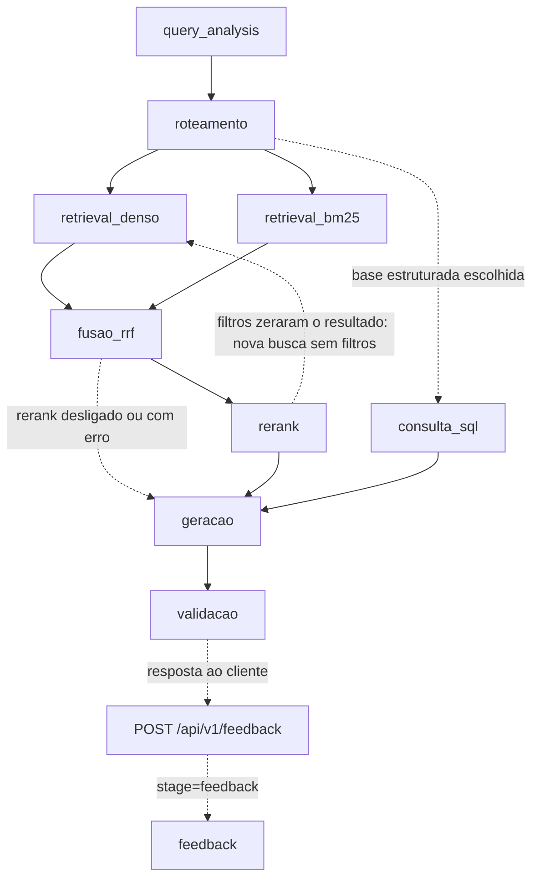

# Arquitetura — Grande Desafio RAG

## 1. Cenário escolhido

**Cenário 1 — Contratações Públicas do Estado do Rio de Janeiro**

Escolhemos o cenário de Contratações Públicas pela disponibilidade de dados verificáveis em fontes oficiais, principalmente o PNCP, e pela diversidade das informações envolvidas. O cenário permite testar uma arquitetura de **Adaptive RAG** combinando análise da consulta, filtros por metadados, busca lexical, busca vetorial, consulta estruturada, rerank, guardrails e validação das respostas.

---

## 2. Pipeline da solução

**O pipeline implementado é composto pelos seguintes estágios:**

- `reformulacao` (só quando o cliente envia `historico` e a pergunta parece continuação)
- `interacao`
- `query_analysis`
- `roteamento`
- `retrieval_denso`
- `retrieval_bm25`
- `fusao_rrf`
- `rerank`
- `consulta_sql`
- `geracao`
- `validacao`

O estágio `feedback` roda fora do pipeline de resposta (é acionado por `POST /api/v1/feedback`, depois que o cliente já recebeu a resposta), mas já está integrado à API e à observabilidade.

### Diagrama do fluxo

### Stages

- `requisicao_inicio`/`requisicao_fim`: envelope do handler API, com resultado HTTP, resposta pública preparada e estado da persistência; `persistencia_historico` registra a tentativa de salvar a consulta. O envelope fecha mesmo em erro, sem depender de logging não estruturado.
- `pipeline_inicio`/`pipeline_fim`: envelope do processamento, com tempo monotônico, versão/contexto de execução e resposta final. Etapas opcionais puladas e fallbacks ficam explícitos; os eventos trazem `extra.schema_version=2`, origem, sequência e resultado normalizado. O trace não soma durações sobrepostas e diferencia fechamento, erro e execução incompleta. Detalhes e limites em [docs/OBSERVABILIDADE.md](docs/OBSERVABILIDADE.md).
- `reformulacao`: o backend não guarda memória entre as perguntas; quem dá o contexto é o cliente, que reenvia as últimas trocas em `historico` no `POST /api/v1/query`. Quando a pergunta parece continuação ("considerando os mesmos contratos…", "E em 2024?"), um filtro determinístico a separa das que já se sustentam sozinhas (essas não chamam o modelo) e o LLM a reescreve usando só as 3 trocas mais recentes, com dado pessoal mascarado e o histórico tratado como dado, não como instrução. A pergunta reescrita substitui a original em todas as etapas seguintes, então os guardrails valem sobre o que de fato é consultado; a resposta devolve o texto digitado em `query` e a reescrita em `pergunta_reformulada`. Qualquer falha do modelo, ou saída fora do formato, mantém a pergunta original. Desligável com `REFORMULACAO_MODE=regras`. Ver [src/reformulacao.py](src/reformulacao.py).
- `interacao`: decide se a mensagem é conversa (saudação, agradecimento, pedido de ajuda, apresentação) ou consulta ao acervo ([src/conversation.py](src/conversation.py)). Conversa é respondida sem consultar o acervo; consulta segue para a `query_analysis`. Tem etapa própria no log para que mensagens de cortesia não apareçam como análise de consulta.
- `query_analysis`: interpreta a pergunta e extrai filtros de ano (incluindo período `ano`/`ano_final`), valor, órgão, esfera, modalidade, métrica (contagem/soma/média/mediana), agrupamento e qual campo de data usar (assinatura, publicação, resultado ou PCA). O órgão é reconhecido também em minúsculas e por sigla (DPE, SEEDUC etc.) e conferido no catálogo de órgãos do corpus ([data/config/orgaos_corpus.json](data/config/orgaos_corpus.json)); "Prefeitura (Municipal) de X" e "Prefeitura do Rio" viram o nome do órgão no PNCP, "MUNICIPIO DE X" ("PREFEITURA MUNICIPAL DE X" é o nome da unidade); citações de norma ("Lei federal 14.133", "Lei do Pregão") não viram esfera nem modalidade. A extração de período foi corrigida para não confundir valores monetários ("acima de 2000 reais") com ano. Todos os filtros são marcados como opcionais, para não eliminar chunks que não possuem o campo correspondente, e o pipeline refaz a busca sem filtros quando eles zeram o resultado.
- `roteamento`: identifica as bases adequadas para responder à consulta e trata perguntas fora do escopo; quando recusa, já infere um motivo (dados bancários, credenciais vazadas, juízo de legalidade, fora de escopo, sem evidência) a partir de pistas na justificativa.
- `retrieval_denso`: realiza recuperação semântica por embeddings.
- `retrieval_bm25`: realiza recuperação lexical por BM25.
- `fusao_rrf`: combina os resultados das buscas densa e lexical usando Reciprocal Rank Fusion.
- `rerank`: reordena os candidatos da fusão com um cross-encoder local (`cross-encoder/mmarco-mMiniLMv2-L12-H384-v1`, multilíngue, via `sentence-transformers`), controlado por `RERANK_ENABLED` e `RERANK_CANDIDATES`. Os campos de conteúdo (objeto/título/descrição) são reordenados antes do rerank para caber na janela de 512 tokens do modelo nos chunks de base estruturada em JSON. Medido em [docs/ABLACAO_RERANK.md](docs/ABLACAO_RERANK.md) no corpus v6, com 47 perguntas (34 parafraseadas + 13 de identificador: número de contrato, CNPJ, pregão, UASG etc.): o rerank sobre o RRF leva o hit@3 de 0,64 para 0,83 no conjunto completo e de 0,46 para 0,85 nas perguntas de identificador — por isso o padrão é RRF + rerank@10 (`RERANK_CANDIDATES=10`). A busca densa sozinha só acha 31% dos identificadores, e o BM25 sozinho erra as perguntas parafraseadas; por isso a fusão híbrida com rerank se mantém, em vez de usar só a busca densa. Ver [src/rerank.py](src/rerank.py).
- `consulta_sql`: para perguntas de conta (ranking, contagem, média/mediana, agrupamento, evolução mensal, listagem com assunto) sobre a base de contratos ou a agregada, consulta a base relacional (Postgres ou SQLite local, conforme `DATABASE_URL`) com SQL fixo (nunca gerado pelo LLM) — na tabela de contratações ou em `pca_planos`, quando a pergunta é sobre o PCA — e injeta o resultado, marcado como `doc_type=sql`, na frente dos chunks recuperados. A base do projeto é o Postgres no Neon; o SQLite versionado em `data/structured/` serve a quem não tem a connection string, aos testes e às avaliações. Regras da consulta:
  - esfera e modalidade vêm do `query_analysis`; o órgão é casado com os nomes do banco (sem aceitar um órgão "federal" ou "regional" que a pergunta não pediu, e com "prefeitura" valendo também como "município");
  - "contratos" conta só contratos assinados, pela data de assinatura (ou de publicação, se a pergunta pedir); "contratações" e "compras" misturam compras e contratos, e a contratação que tem os dois registros conta uma vez (coluna `numero_controle_compra`);
  - valores abaixo de R$ 1,00 (R$ 0,00 e R$ 0,01 simbólicos do PNCP) ficam fora de média, mediana, evolução e ranking, e são contados à parte;
  - "tecnologia" é lida como TI (tecnologia da informação, informática, software, TIC);
  - quando nenhum registro informa a modalidade, o resultado diz que não é possível saber; quando a pergunta cita uma lei, o resultado avisa que a norma não é filtro (os contratos assinados não trazem o amparo legal).

  Ver [src/structured_query.py](src/structured_query.py) e [src/structured_db.py](src/structured_db.py).
- `geracao`: gera a resposta somente a partir das evidências recuperadas, com guardrails e política de sensibilidade. O orçamento de contexto é controlado por `GENERATION_CONTEXT_CHARS` e `GENERATION_CHUNK_CHARS`, e cada chamada ao LLM usa `GENERATION_TIMEOUT` (180 s) e até `GENERATION_MAX_RETRIES` tentativas extras além da primeira, para não travar uma pergunta por até 30 minutos quando o servidor compartilhado da turma engasga (ver [config.py](config.py)).
- `validacao`: valida a saída do LLM, trata JSON inválido, remove citações inexistentes e mascara dados pessoais quando necessário. Também converte recusas indevidas: quando o roteador já colocou a pergunta no escopo e o LLM escreveu uma resposta com evidência parcial mas ainda assim marcou recusa por "fora de escopo" ou "sem evidência", a recusa vira resposta com confiança baixa, e a conversão fica registrada como `recusa_convertida` no log (`_converter_recusa_indevida` em [src/generate.py](src/generate.py)). Recusas de guardrail (dados bancários, credenciais, juízo de legalidade) nunca são convertidas.
- `feedback`: não roda dentro de `responder`, e sim quando o usuário avalia uma resposta já entregue. `POST /api/v1/feedback` associa a avaliação (`positivo`/`negativo` + comentário opcional) ao `query_id` da consulta original (404 se ele não existir) e grava o evento no log com esse mesmo `run_id`, amarrando-o aos demais stages da pergunta. Persistência e histórico em [src/history_store.py](src/history_store.py).

### Estado atual

Já estão implementados:

- Adaptive RAG com roteamento por tipo de evidência;
- recuperação híbrida com busca densa + BM25 + RRF + rerank por cross-encoder;
- consulta a base estruturada em SQL (Postgres/SQLite) para perguntas sobre contratos;
- filtros por metadados com fallback quando a filtragem retorna vazio;
- guardrails para perguntas fora do escopo e ausência de evidência, com motivo de recusa inferido;
- política de sensibilidade e mascaramento de dados pessoais;
- validação da resposta gerada;
- observabilidade estruturada por `run_id`, `query_id`, `session_id`, origem, sequência e outcome; envelopes API/pipeline com tempo monotônico, persistência do histórico, metadados de versão e resumo SQL/vetorial que distingue tentativa de retorno de evidências (`resumo_consulta`);
- coleta e versionamento do corpus por manifesto (atualmente na versão v6);
- preparação de documentos, OCR, embeddings e indexação;
- API FastAPI com `GET /health`, `POST /api/v1/query`, `POST /api/v1/feedback`, `GET /api/v1/history`, `GET /api/v1/trace/{query_id}` e `GET /api/v1/sessions/{session_id}/trace` (caminho da pergunta e da conversa, [src/trace.py](src/trace.py));
- feedback do usuário e histórico de consultas persistidos em SQLite local ([src/history_store.py](src/history_store.py));
- CORS configurado para desenvolvimento local e para a origem `https://etuarda.github.io`;
- demonstração do frontend publicada em [https://etuarda.github.io/frontendRAG/](https://etuarda.github.io/frontendRAG/), em repositório separado, hoje consumindo só `GET /health` e `POST /api/v1/query`, ainda sem telas para `feedback`/`history` e sem um backend público em HTTPS para o site apontar;
- suporte a certificados HTTPS com `certifi` sem desabilitar validação SSL;
- golden set e estrutura de avaliação automatizada: 22 casos (22/22 em rota e recusa, citação 21/22 — golden-v6-final, mede rota e recusa, não se o conteúdo está certo), mais um conjunto de busca com 47 perguntas e a ablação do rerank;
- 895 testes automatizados passando na verificação realizada em 2026-10-02.

### Corpus e índice

As bases oficiais definidas no manifesto são:

- `contratos_estruturado`;
- `editais_normativo`;
- `atas_conversacional`;
- `pca_agregado`.

O inventário vigente é a versão v6, registrada em `data/inventory/v6.json` e resumida em `CORPUS_INVENTORY.md` e `docs/registro_execucao_v6.md`: **1.400 arquivos** no total (contratos_estruturado 625, editais_normativo 13, atas_conversacional 376, pca_agregado 386), distribuídos por esfera em municipal 804, federal 513 e estadual 83, com limite de até 5 documentos por órgão/base. O histórico de reconstrução do inventário entre as versões está documentado em `data/inventory/DIFF_v2_v3.md`, `DIFF_v3_v4.md` e `DIFF_v4_v5.md`.

O índice oficial vigente ([index/manifest.json](index/manifest.json)) usa embeddings `Qwen3-Embedding-0.6B.Q8_0` (dimensão 1024) em índice FAISS (`index/*/vectors.faiss`), gerados a partir de `data/normalized/v6/documents.jsonl`. Depois da recuperação OCR de 2026-10-07 ([src/qualidade_corpus.py](src/qualidade_corpus.py), relatório em [data/inventory/qualidade_v6.json](data/inventory/qualidade_v6.json)), ele tem **5.090 vetores** da v6, mais os 25 das conversas sintéticas (**5.115 no total**), sem trechos ilegíveis:

- 625 chunks de `contratos_estruturado`;
- 1.557 chunks de `editais_normativo`;
- 1.997 chunks de `atas_conversacional`;
- 911 chunks de `pca_agregado`.

Foram preservados os vetores dos textos inalterados. A recuperação produziu 305 novos registros vetoriais a partir de 283 textos distintos, com o mesmo checkpoint e configuração do índice. Os 826 chunks anteriormente excluídos foram substituídos por texto legível e nova segmentação: 52 páginas de 3 atas passaram pelo Tesseract (`por`), e os códigos `/U0044` de 7 páginas dos Decretos 48.816 e 48.760 foram decodificados, inclusive nos cabeçalhos de páginas majoritariamente legíveis. Números de página permanecem junto do parágrafo ou seção, sem virar chunks isolados. O manifesto histórico da coleta foi recuperado por hash, sem alterar o manifesto atual ou os arquivos brutos. Detalhes em [eval/runs/v6-ocr-recovery.json](eval/runs/v6-ocr-recovery.json). SQLite e Neon ainda precisam ser remontados pelo responsável pela base estruturada.

**Limitações conhecidas da v6:**
- os indicadores do PCA (`pca_agregado`) estão praticamente ausentes do corpus coletado (só um PCA confirmado, da Secretaria de Saúde estadual);
- 445 dos 448 contratos assinados continuam sem `modalidade`: o PNCP não traz modalidade em contrato assinado, e só 3 deles têm a compra vinculada no corpus (eles herdam a modalidade dela). Preencher os outros exige coletar a compra de cada contrato (`numeroControlePncpCompra`) numa nova versão do corpus. Das 177 publicações de compra, só 2 têm contrato no corpus para herdar o fornecedor;
- as normas têm início de vigência (`extras.data_vigencia_inicio`, declarado no manifesto ou vindo da publicação da compra no PNCP), mas não fim: nenhuma norma do corpus foi revogada. `data_vigencia` continua vazio nelas, porque no projeto ele é o fim da vigência ("vigente até"). Os textos são compilações atuais: a vigência histórica de cada dispositivo não foi verificada;
- há só 1 registro de "ambulância tipo D" (valor R$ 0,00), insuficiente para perguntas de mediana ou comparação entre esferas;
- 21 contratos têm valor R$ 0,00, 6 têm R$ 0,01 e 17 compras têm valor estimado R$ 0,00 (valores simbólicos, marcados com `extras.valor_simbolico`); a `consulta_sql` os deixa fora das contas de valor, e o prompt avisa que esse valor não é o custo real;
- o amparo legal só vem nas compras publicadas: nos contratos assinados ele é nulo, então não dá para contar contratos por lei.

Os diretórios `index/`, `data/normalized/`, `data/structured/` e `data/embeddings/2026-10-07_21-18-41_ocr-recovery/` estão no `.gitignore`, mas são versionados via `git add -f` (forçado) para que o time compartilhe o índice e o corpus processado sem reprocessar tudo localmente. Os inventários `data/inventory/*.json` são versionados normalmente, e os dois ZIPs da v6 em `atas-zip/` entram por exceção explícita no `.gitignore`. O `-text` do `.gitattributes` nesses caminhos preserva os bytes exatos (sem conversão CRLF/LF), porque os hashes de proveniência dependem deles. `data/app_state/` (onde fica o histórico de perguntas dos usuários, `src/history_store.py`) **não** está nessa lista e permanece fora do Git. A geração do corpus normalizado depende de OCR local (Tesseract + pacote de idioma português) instalado na máquina de quem roda o `prepare`.

---

## 3. Divisão de responsabilidades

As tarefas são distribuídas entre os integrantes a cada encontro conforme as necessidades do projeto, dependências entre módulos e pendências encontradas nas revisões. A equipe não mantém uma divisão fixa por pessoa.

### Como as tarefas são organizadas

- **A cada encontro**, a equipe revisa o estado do projeto e distribui as próximas atividades.
- **As dependências entre módulos** são consideradas para evitar trabalhos conflitantes, principalmente entre coleta, indexação, análise de consulta e avaliação.
- **As revisões** geram novos ajustes e tarefas para os encontros seguintes.
- **O registro individual das contribuições** fica em `acompanhamento/ACOMPANHAMENTO_*.md`.

### Frentes atuais

- Qualidade do corpus v6 (indicadores do PCA, contratos sem modalidade); recuperação OCR concluída.
- Gabarito de conteúdo do golden set.
- Integração do frontend com `feedback`/`history` e com a tela de rastreabilidade (`session_id` e trace).
- Preparação para o Demo Day.

### Pendências em aberto

- Melhorar a cobertura de indicadores do PCA e dos contratos sem `modalidade`
  (o contrato do PNCP não traz a modalidade; cobertura medida em
  [docs/QUALIDADE_DOS_DADOS.md](docs/QUALIDADE_DOS_DADOS.md) e limitação
  estrutural em `docs/registro_execucao_v6.md`). O OCR das atas já foi
  recuperado e SQLite e Neon foram remontados em 2026-10-09 (schema 7, com
  `fornecedor_cnpj`).
- Rodar o golden set de novo com os critérios de conteúdo do avaliador
  (radicais, tetos de confiança e negação). Última rodada completa
  (`golden-2026-10-09-cnpj`, antes desses critérios): 14/26; rota 24/26,
  recusa 26/26, citação 25/26. Conferir na nova rodada a F1, que deve admitir a
  insuficiência de dados com confiança no máximo baixa.
- Reescrever as perguntas do golden set que dependem da anterior ("nesses
  contratos") e incluir casos da base de atas e de identificador (CNPJ,
  número de controle). Entra na re-auditoria junto com a promoção do v7.
- Fazer o frontend (repositório separado) mostrar os `avisos` da resposta e o
  trace ao lado dela; falta também um backend público em HTTPS para o site
  apontar.
- Histórico com dois personas: `X-API-Key` (`RAG_API_KEY`) vê o histórico
  inteiro e o `X-Session-Id` vê só a própria conversa; `HISTORY_PUBLIC=true`
  abre o histórico geral para uma demo. O histórico grava textos mascarados com
  expurgo após `HISTORY_RETENTION_DAYS` dias. O log mascarado em
  `logs/pipeline/` segue `LOG_RETENTION_DAYS` (por padrão, a retenção do
  histórico); diagnósticos em `logs/maintenance/` seguem 14 dias via
  manutenção explícita, sem expurgar backups.
- Avaliar respostas e guardrails sobre o suplemento `emails_sinteticos`,
  gerado pelo tutor e integrado em 2026-10-05: 25 conversas, 20 públicas e 5
  restritas ([proveniência e reconstrução](docs/emails_sinteticos.md)).
- Decidir o tratamento definitivo para os diretórios ignorados pelo `.gitignore`
  mas versionados via `git add -f` (`index/`, `data/normalized/`,
  `data/structured/`, `data/embeddings/2026-09-30_12-08-51/`).
- No `query_analysis`, reconhecer o fornecedor por apelido ("Infolog"): o
  município citado sozinho e o fornecedor pelo nome já viram filtro, mas o
  apelido ainda cai no termo do objeto e responde "nenhum registro".
- Estabilizar o ranking: com `top_k` não exaustivo, a mesma pergunta pode
  recuperar conjuntos diferentes entre execuções (P2.1 e P4.2 oscilam).
- Preparação do Demo Day (23/10): faltam roteiro cronometrado, plano B gravado
  e checkpoint de freeze.

---

## 4. Coordenação da equipe

**Coordenador:** Renato Lemos

Renato Lemos coordena a equipe, acompanha o andamento do projeto, apoia a organização e distribuição das tarefas e participa das decisões técnicas e do desenvolvimento.

A coordenação pode ser ajustada ao longo das sprints conforme decisão da equipe.
