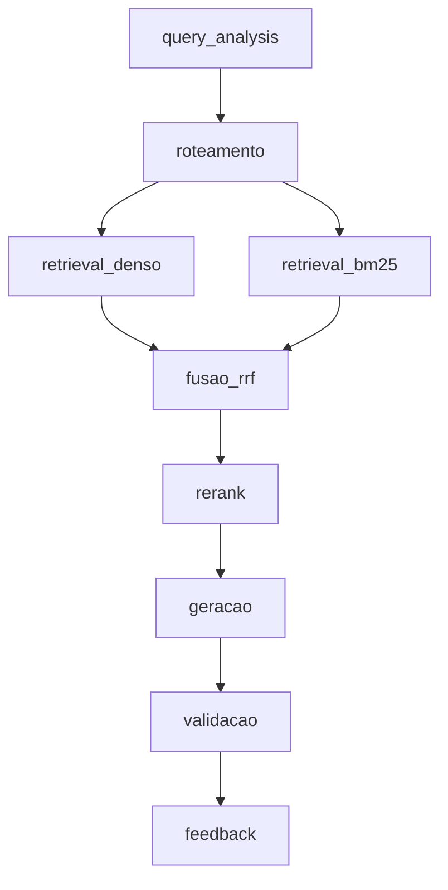

# RAG — Grande Desafio · Cenário 1: Contratações Públicas do RJ

**Residência TIC em Trilhas · PUC-Rio · Instituto ECOA**

Sistema de **Adaptive RAG** sobre contratações públicas do Estado do Rio de Janeiro: dado uma pergunta em linguagem natural, o sistema decide sozinho **onde buscar** (norma, registro estruturado, conversa ou número agregado) antes de buscar, recupera evidência híbrida (densa + BM25 + RRF + rerank) e gera uma resposta citando fontes — ou recusa, quando o caso exige.

## Por que este cenário

Todo órgão público brasileiro publica suas contratações no [PNCP](https://pncp.gov.br) por força da Lei 14.133/2021, mas o portal só permite consulta contrato a contrato — não permite cruzar edital, contrato, ata de registro de preços e valores homologados numa única pergunta. Este projeto constrói essa camada de consulta.

Escolhemos o Cenário 1 por ser o **mais verificável** dos três disponíveis (qualquer resposta pode ser conferida diretamente no portal do PNCP) e por oferecer o melhor contraste entre busca esparsa e densa: número de contrato e CNPJ só aparecem com BM25; "compra de equipamento hospitalar" só aparece com embeddings.

Contexto completo do desafio, dos outros dois cenários e dos padrões de engenharia exigidos está em [GRANDE_DESAFIO_CENARIOS.md](GRANDE_DESAFIO_CENARIOS.md).

## As quatro bases de conhecimento

| Base | Natureza | Conteúdo | Fonte | Acesso |
| --- | --- | --- | --- | --- |
| `editais_normativo` / `fontes_normativas` | Normativa | Lei 14.133/2021, decretos estaduais, editais de licitação | Planalto, REDELOG-RJ, CGE-RJ, PNCP | PDF/HTML por URL |
| `contratos_estruturado` | Estruturada | Contratos e contratações, UF=RJ, período fechado | PNCP — API de consulta v3 | REST paginado |
| `atas_conversacional` | Conversacional | Atas de registro de preço, e-mails de compras (base sintética) | PNCP + base sintética | Texto |
| `pca_agregado` | Agregada | Plano de Contratações Anual, valores homologados por item | PNCP | REST |

A definição declarativa de cada base — fonte, tipo de acesso, volume-alvo, campo de vigência, licença — vive em [corpus_manifest.yaml](corpus_manifest.yaml), que é a fonte única de verdade sobre o que entra no corpus. `data/raw/` nunca é versionado; qualquer pessoa reconstrói o corpus rodando o coletor contra o manifesto.

> A API do PNCP **não tem busca textual**. Filtro por objeto é feito localmente, e o recorte de dados é sempre determinístico (mesmo manifesto ⇒ mesmo corpus).

## Roteamento adaptativo — a ideia central

A pergunta que o roteador responde não é "sobre o que o usuário falou", e sim "que tipo de evidência responde isso". Três perguntas quase idênticas em vocabulário podem exigir três rotas distintas:

- *"Qual foi o valor médio por quilo de arroz contratado por municípios do RJ em 2025?"* → agregada + estruturada.
- *"Quais contratos de licenciamento de software foram assinados acima de R$ 500 mil em 2025?"* → estruturada, com filtro numérico extraído da pergunta.
- *"Sou MEI, posso participar de pregão eletrônico? Tem algum aberto pra material de escritório?"* → normativa (tratamento a ME/EPP) **e** estruturada (contratações em aberto) na mesma pergunta.

As personas de referência, com as nove perguntas classificadas por rota esperada e tipo, estão em [PERSONAS.md](PERSONAS.md).

## Política de sensibilidade

Classificação feita na **ingestão** (metadado `sensitivity` em cada chunk), nunca delegada ao LLM na hora de responder:

- **Responder:** valores de contrato, nome de empresa fornecedora, CNPJ de pessoa jurídica, objeto contratado — público por lei.
- **Mascarar:** CPF de pessoa física contratada, telefone e e-mail pessoal de servidor que aparecem em atas.
- **Recusar:** dados bancários de fornecedor, credenciais vazadas em e-mail, juízo sobre a legalidade de um contrato específico (o sistema apresenta dados, não acusa). Ver `RefusalReason` em [src/schema.py](src/schema.py).

## Pipeline



Estágios (mesmos nomes usados no campo `stage` do log estruturado): `query_analysis`, `roteamento`, `retrieval_denso`, `retrieval_bm25`, `fusao_rrf`, `rerank`, `geracao`, `validacao`, `feedback`. Detalhes de decisão e divisão de responsabilidades em [ARQUITETURA.md](ARQUITETURA.md).

## Estrutura do repositório

```
├── acompanhamento/              ← relato individual + resumo do dia, a cada encontro
├── docs/                         ← guia da interface CLI e capturas de tela
├── data/
│   ├── raw/                     ← corpus bruto coletado (ignorado pelo Git)
│   ├── runs/                    ← relatórios de execução de cada coleta
│   └── CORPUS_INVENTORY.md      ← inventário legível do corpus coletado
├── testes/test-fontes/          ← verificação de disponibilidade das fontes e downloader compartilhado
├── tests/                       ← testes de contrato (pytest), offline
├── src/
│   ├── fetch_corpus.py          ← coleta determinística e versionada do corpus
│   ├── manifest_curator.py      ← descoberta e propostas para o manifesto
│   ├── source_lookup.py         ← busca remota nas fontes suportadas
│   ├── corpus_search.py         ← busca local no inventário
│   ├── ingest.py                ← normalização de brutos em chunks (JSONL)
│   └── schema.py                ← modelos Pydantic (chunk, roteamento, resposta, recusa)
├── llm_ecoa.py                  ← exemplo mínimo de geração e embedding via endpoint compartilhado
├── corpus_manifest.yaml         ← o que entra no corpus (fonte única de verdade)
├── ARQUITETURA.md               ← pipeline, estágios e divisão de responsabilidades
├── PERSONAS.md                  ← personas e perguntas de referência
└── .env.example                 ← variáveis necessárias, sem valores reais
```

## Como rodar

O guia visual da interface de coleta, curadoria e busca está em
[docs/README.md](docs/README.md), com exemplos de comandos e capturas de tela
da CLI.

**1. Configurar ambiente**

```bash
python -m venv .venv
.venv\Scripts\activate          # Windows
pip install -r requirements.txt
copy .env.example .env          # preencher se necessário; os defaults já apontam para o endpoint da turma
```

**2. Coletar o corpus** (materializa versões imutáveis a partir do manifesto)

```bash
py -m src.fetch_corpus fetch --manifest corpus_manifest.yaml --official
py -m src.fetch_corpus update --manifest corpus_manifest.yaml --official
py -m src.fetch_corpus inventory --corpus-version v1 --official
```

**Curar novas fontes antes da coleta**

`source_catalog` pode descobrir fontes e gerar propostas sem alterar o
manifesto. A incorporação oficial exige revisão e `apply`, que valida o hash
do manifesto antes de escrever:

```bash
py -m src.source_catalog discover
py -m src.source_catalog lookup pncp --query "contratação software" --uf RJ --year 2025
py -m src.source_catalog propose --manifest corpus_manifest.yaml
py -m src.source_catalog manifest-diff --manifest corpus_manifest.yaml --proposal data/proposals/manifest-proposal-AAAA.json
py -m src.source_catalog review --proposal data/proposals/manifest-proposal-AAAA.json
py -m src.source_catalog apply --manifest corpus_manifest.yaml --proposal data/proposals/manifest-proposal-AAAA-reviewed.json
```

O comando `apply` é o único dessa interface que altera o manifesto. Depois da
revisão, use `fetch` ou `update` para materializar a definição aprovada.

`lookup` pesquisa uma fonte remota suportada, mas não incorpora resultados ao
corpus automaticamente. Para pesquisar o que já foi coletado, use o inventário:

```bash
py -m src.corpus_search search local \
  --corpus-version v1 \
  --query "edital 90012" \
  --base-id documentos_pncp
```

Essa busca inicial consulta apenas metadados (`logical_id`, base, origem,
caminho, tipo e hash); ela não faz busca textual dentro de PDFs.

Para inspecionar um update sem rede nem escrita:

```bash
py -m src.fetch_corpus update --manifest corpus_manifest.yaml --official --dry-run
```

Use `--official` somente para operar a árvore principal `data/`. Sem essa
flag, a execução é experimental e exige um `--data-root` separado. Cada
tentativa terá seu próprio `raw/`, `inventory/`, `runs/` e
`CORPUS_INVENTORY.md`:

```bash
py -m src.fetch_corpus fetch --manifest corpus_manifest.yaml --data-root data/attempts/corpus_fetch/tentativa-v5
py -m src.fetch_corpus update --manifest corpus_manifest.yaml --data-root data/attempts/corpus_fetch/tentativa-v5
py -m src.fetch_corpus inventory --corpus-version v1 --data-root data/attempts/corpus_fetch/tentativa-v5
```

O diretório `data/attempts/` é experimental e pode ser versionado seletivamente
como histórico de testes; ele não substitui a v1 oficial em `data/raw/` e
`data/inventory/`.

Para uma verificação rápida após clonar o repositório, há 20 PDFs pequenos em
`tests/fixtures/pdf/`. A base `exemplos_teste` está declarada no manifesto
principal e pode ser executada em uma área experimental:

```bash
py -m src.fetch_corpus fetch `
  --manifest corpus_manifest.yaml `
  --data-root data/attempts/corpus_fetch/demo `
  --base-id exemplos_teste

pytest tests/ -m "not llm"
pytest testes/test_fetch_corpus.py -q
```

Os PDFs são amostras de entrada para inspeção e testes locais. A base usa
`arquivo_local`, não faz requisições externas e só entra no corpus quando o
comando é executado; usando `--data-root`, a execução não altera `data/raw/`.

**3. Preparar documentos e PDFs** (extrai formatos, organiza metadados e grava chunks JSONL)

```bash
py -m src.prepare_documents `
  --input tests/fixtures/pdf `
  --manifest corpus_manifest.yaml `
  --base-id exemplos_teste `
  --output data/attempts/corpus_fetch/demo/normalized/documents.jsonl `
  --report data/attempts/corpus_fetch/demo/normalized/extraction_report.json

py -m src.prepare_documents `
  --input tests/fixtures/pdf `
  --manifest corpus_manifest.yaml `
  --base-id exemplos_teste `
  --dry-run
```

Quando a entrada veio de uma coleta já registrada, informe também o inventário
correspondente. O preparador usa `base_id + SHA-256` para recuperar a origem
específica e o horário real de coleta de cada arquivo:

```bash
py -m src.prepare_documents `
  --input data/raw/v1/contratos_estruturado `
  --manifest corpus_manifest.yaml `
  --base-id contratos_estruturado `
  --inventory data/inventory/v1.json `
  --output data/attempts/corpus_fetch/demo/normalized/contratos.jsonl `
  --report data/attempts/corpus_fetch/demo/normalized/contratos_report.json
```

O script separado trata PDF, HTML, TXT, Markdown, CSV, JSON e JSONL. O
chunking é adaptativo conforme `chunking_sugerido` do manifesto: registros
estruturados permanecem inteiros, enquanto documentos normativos são divididos
por cláusulas/artigos quando esses cabeçalhos existem, usando o chunking
genérico como fallback. Cada chunk preserva `source_file`, `chunk_id`,
`parent_chunk_id`, `base_id`, `natureza`, `doc_type` (formato original), `sensitivity`,
SHA-256, página, vigência e proveniência no manifesto. `src/ingest.py` mantém
uma fachada compatível para esse mesmo fluxo oficial.

A base opcional `licitacoes_siga_csv` usa o CSV público da SEPLAG-RJ. O parser
detecta o delimitador publicado, preserva os nomes reais das colunas e cria um
chunk por licitação. A amostra versionada em `tests/fixtures/formats/` contém
50 linhas reais para testes rápidos; a URL do manifesto permite reconstruir o
arquivo completo.

**4. Criar embeddings com cache**

Primeiro valide sem chamar o endpoint:

```bash
py -m src.create_embeddings `
  --input data/attempts/corpus_fetch/demo/normalized/documents.jsonl `
  --output data/attempts/corpus_fetch/demo/embeddings/embeddings.jsonl `
  --dry-run
```

Com o endpoint configurado, remova `--dry-run`. O padrão usa lotes de 64,
pausa de 10 segundos entre chamadas e partes de até 45 MiB, seguindo a mesma
estratégia de persistência incremental da inspiração:

```bash
py -m src.create_embeddings `
  --input data/attempts/corpus_fetch/demo/normalized/documents.jsonl `
  --output data/attempts/corpus_fetch/demo/embeddings/embeddings.jsonl
```

O cache é indexado pelo SHA-256 do conteúdo e por uma impressão digital dos
metadados semânticos do chunk. Textos idênticos podem ser reutilizados quando
pertencem ao mesmo contexto; alterações em `base_id`, natureza, origem,
manifesto, vigência ou sensibilidade invalidam o embedding anterior. A
execução deixa, no mesmo diretório, `embeddings.part-0001.jsonl` (partes
atômicas) e `embedding_report.json` (estatísticas). Se o processo for
interrompido, a execução seguinte reutiliza somente registros compatíveis.

O diretório `data/embeddings/` fica versionável, como na inspiração. A
materialização pública atual está em
[`data/embeddings/embeddings.jsonl`](data/embeddings/embeddings.jsonl), com o
relatório em [`data/embeddings/embedding_report.json`](data/embeddings/embedding_report.json).
Assim, o professor pode testar a leitura e a indexação diretamente após clonar
o repositório. Novas execuções de desenvolvimento devem usar
`data/attempts/`, que continua fora do Git.

As opções de provedor são `ecoa`, `ollama`, `openai` e `custom`. O cache registra
provedor, endpoint e modelo para impedir a mistura de espaços vetoriais
diferentes.

**5. Testar o endpoint de LLM/embeddings compartilhado**

```bash
python llm_ecoa.py
```

**6. Rodar os testes**

```bash
pytest tests/ -m "not llm"      # camadas unitária e de contrato, offline
```

### Endpoint de modelos (compartilhado com toda a turma)

```python
OLLAMA_URL       = "http://ecoa-llm.duckdns.org:11434/v1"
GENERATION_MODEL = "qcwind/qwen3-8b-instruct-Q4-K-M"
EMBEDDING_MODEL  = "xagi/qwen3-embedding:0.6b-q4_k_m"
```

Como o endpoint é compartilhado por toda a turma: cache de embeddings em disco é obrigatório, índices devem ser persistidos e recarregados (nunca reindexados a cada execução), e lotes devem ser pequenos com pausa entre chamadas.

Acompanhamento detalhado dia a dia em [acompanhamento/ACOMPANHAMENTO.md](acompanhamento/ACOMPANHAMENTO.md).

---

*TIC em Trilhas · PUC-Rio · Instituto ECOA · MCTI Futuro · Softex*
