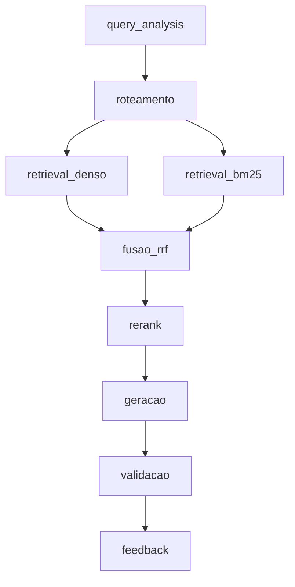

# RAG — Grande Desafio · Cenário 1: Contratações Públicas do RJ

**Residência TIC em Trilhas · PUC-Rio · Instituto ECOA**

## API HTTP

O backend FastAPI expõe `GET /health` e `POST /api/v1/query`. Para executar
localmente:

```bash
uvicorn app.api:app --reload --host 127.0.0.1 --port 8000
```

Os servidores Vite locais em `localhost:5173` e `127.0.0.1:5173` já estão
permitidos por CORS. Origens adicionais podem ser informadas, separadas por
vírgula, em `CORS_ALLOW_ORIGINS`.

Sistema de **Adaptive RAG** sobre contratações públicas do Estado do Rio de Janeiro: dado uma pergunta em linguagem natural, o sistema decide sozinho **onde buscar** (norma, registro estruturado, conversa ou número agregado) antes de buscar, recupera evidência híbrida (densa + BM25 + RRF + rerank) e gera uma resposta citando fontes — ou recusa, quando o caso exige.

## Por que este cenário

Todo órgão público brasileiro publica suas contratações no [PNCP](https://pncp.gov.br) por força da Lei 14.133/2021, mas o portal só permite consulta contrato a contrato — não permite cruzar edital, contrato, ata de registro de preços e valores homologados numa única pergunta. Este projeto constrói essa camada de consulta.

Escolhemos o Cenário 1 por ser o **mais verificável** dos três disponíveis (qualquer resposta pode ser conferida diretamente no portal do PNCP) e por oferecer o melhor contraste entre busca esparsa e densa: número de contrato e CNPJ só aparecem com BM25; "compra de equipamento hospitalar" só aparece com embeddings.

Contexto completo do desafio, dos outros dois cenários e dos padrões de engenharia exigidos está em [GRANDE_DESAFIO_CENARIOS.md](GRANDE_DESAFIO_CENARIOS.md).

## As quatro bases de conhecimento

| Base | Natureza | Conteúdo | Fonte | Acesso |
| --- | --- | --- | --- | --- |
| `editais_normativo` | Normativa | Lei 14.133/2021, decretos estaduais, editais de licitação | Senado Federal, REDELOG-RJ, CGE-RJ, MPPI | PDF/HTML por URL |
| `contratos_estruturado` | Estruturada | 160 contratações publicadas em 2025, UF=RJ | PNCP — API de consulta | REST paginado |
| `atas_conversacional` | Conversacional | 20 atas de registro de preços do Estado do RJ: metadados, lista de arquivos e os PDFs das atas; e-mails de compras (base sintética, a ser criada com o tutor) | PNCP + base sintética | REST (JSON) + PDF |
| `pca_agregado` | Agregada | Plano de Contratações Anual 2024–2025 do Estado do RJ, transformado em indicadores | PNCP | REST (CSV + JSON) |

A definição declarativa de cada base — fonte, tipo de acesso, volume-alvo, campo de vigência, licença — vive em [corpus_manifest.yaml](corpus_manifest.yaml), que é a fonte única de verdade sobre o que entra no corpus. `data/raw/` nunca é versionado; qualquer pessoa reconstrói o corpus rodando o coletor contra o manifesto.

Só as bases com `escopo: oficial` no manifesto (uma por natureza) respondem perguntas; as marcadas como `experimental` ficam fora da busca (`ESCOPOS_CONSULTADOS` em [src/pipeline.py](src/pipeline.py)).

**Base agregada.** O CSV do PCA traz um item planejado por linha (~39,5 mil no Estado do RJ em 2025). Em vez de um chunk por linha, a preparação calcula indicadores com [src/pca_indicators.py](src/pca_indicators.py): visão geral, e totais, participação e ranking por categoria, unidade responsável, classe de catálogo e mês, além de rankings das 30 maiores unidades e classes. Cada indicador vira **um chunk** com os números já calculados (cerca de 1.000 no total). Assim o LLM cita valores prontos, em vez de tentar somar linhas.

**Base conversacional.** A API de atas do PNCP ignora o filtro `uf`; o recorte do RJ é feito pelo CNPJ do órgão (`cnpjs` no manifesto, o mesmo do PCA). Para cada ata, o coletor baixa o JSON de metadados, a listagem `/arquivos` e cada PDF anunciado nela. Parte desses PDFs é escaneada, sem texto; com o Tesseract instalado, a preparação aplica OCR nessas páginas ([src/ocr.py](src/ocr.py)). Os chunks do PDF herdam da mesma ata a vigência (`dataVigenciaFim`) e o título do documento, que também aparecem para o LLM no cabeçalho de cada trecho — assim ele distingue a ata de uma publicação no Diário Oficial anexada a ela.

> A API do PNCP **não tem busca textual**. Filtro por objeto é feito localmente, e o recorte de dados é sempre determinístico (mesmo manifesto ⇒ mesmo corpus).

## Roteamento adaptativo — a ideia central

A pergunta que o roteador responde não é "sobre o que o usuário falou", e sim "que tipo de evidência responde isso". Três perguntas quase idênticas em vocabulário podem exigir três rotas distintas:

- *"Qual foi o valor médio por quilo de arroz contratado por municípios do RJ em 2025?"* → agregada + estruturada.
- *"Quais contratos de licenciamento de software foram assinados acima de R$ 500 mil em 2025?"* → estruturada, com filtro numérico extraído da pergunta.
- *"Sou MEI, posso participar de pregão eletrônico? Tem algum aberto pra material de escritório?"* → normativa (tratamento a ME/EPP) **e** estruturada (contratações em aberto) na mesma pergunta.

As seis personas de referência, com as 18 perguntas classificadas por rota esperada e tipo (mais uma pergunta de falha esperada), estão em [PERSONAS.md](PERSONAS.md) — e viraram o golden set que `eval/run_eval.py` roda contra o pipeline. `src/router.py` já implementa esse roteamento de forma determinística (regex sobre o texto normalizado da pergunta, sem chamar o LLM).

## Política de sensibilidade

Classificação feita na **ingestão** (metadado `sensitivity` em cada chunk), nunca delegada ao LLM na hora de responder:

- **Responder:** valores de contrato, nome de empresa fornecedora, CNPJ de pessoa jurídica, objeto contratado — público por lei.
- **Mascarar:** CPF de pessoa física contratada, telefone e e-mail pessoal de servidor que aparecem em atas.
- **Recusar:** dados bancários de fornecedor, credenciais vazadas em e-mail, juízo sobre a legalidade de um contrato específico (o sistema apresenta dados, não acusa). Ver `RefusalReason` em [src/schema.py](src/schema.py).

Como é aplicada ([src/sensitivity.py](src/sensitivity.py), chamado por [src/generate.py](src/generate.py)):

- **Mascaramento determinístico (regex), em dois pontos:** no contexto antes do prompt (o LLM nunca vê o dado) e na resposta final (caso o dado venha da própria pergunta). CPF formatado é sempre mascarado; CPF só com dígitos e telefone sem DDD entre parênteses/`+55` só quando rotulados (`CPF:`, `Tel.:`), para não mascarar ids de processo. E-mails de domínio institucional (`.gov.br`, `.jus.br`, `.mp.br`, `.leg.br`, `.def.br`, `.mil.br`) são preservados; os demais viram `[e-mail omitido]`. CNPJ não é tocado.
- **Chunks `sensitivity=restrito` são descartados** antes da geração; se só sobrarem restritos, a resposta é recusa `sem_evidencia`.
- O log de geração registra quantos dados foram mascarados por tipo (`mascaramentos`) e quantos chunks restritos foram descartados — nunca o valor original.
- Testes em [tests/test_sensitivity.py](tests/test_sensitivity.py).

## Pipeline



Estágios (mesmos nomes usados no campo `stage` do log estruturado): `query_analysis`, `roteamento`, `retrieval_denso`, `retrieval_bm25`, `fusao_rrf`, `rerank`, `geracao`, `validacao`, `feedback`. Detalhes de decisão e divisão de responsabilidades em [ARQUITETURA.md](ARQUITETURA.md).

**Implementado:**

- `query_analysis` ([src/query_analysis.py](src/query_analysis.py)): extrai da pergunta, sem LLM, filtros de ano, valor (mínimo, máximo, faixa) e órgão.
- `roteamento` ([src/router.py](src/router.py)): escolhe as bases antes de buscar.
- `retrieval_denso` / `retrieval_bm25` / `fusao_rrf` ([src/retrieve.py](src/retrieve.py)): busca híbrida com filtros de metadado. Os filtros são aplicados base a base: numa base sem o campo filtrado, ou em que o filtro excluiria todos os chunks, ele é ignorado e o log registra isso em `extra.filtros_ignorados`. Se ainda assim os filtros zerarem o resultado, [src/pipeline.py](src/pipeline.py) refaz a busca sem eles.
- `geracao` ([src/generate.py](src/generate.py)): guardrails determinísticos antes do LLM, prompt limitado à janela do modelo (`GENERATION_CONTEXT_CHARS` no total e `GENERATION_CHUNK_CHARS` por chunk; o log registra `chunks_no_prompt` e `chunks_fora_do_orcamento`) e saída pedida em JSON (`response_format`).
- `validacao` ([src/generate.py](src/generate.py)): checa a saída do LLM. JSON inválido vira recusa segura, citação de chunk que não foi recuperado é descartada (`extra.citacoes_descartadas`) e dado pessoal na resposta é mascarado.

[src/pipeline.py](src/pipeline.py) une as etapas numa única função (`responder`).

**Ainda não implementados:** `rerank` (o `retrieve` aceita um reranker plugável, mas nenhum é usado; o modelo de rerank da turma ainda não foi liberado) e `feedback`.

O parsing da geração aceita as variações de chave que o modelo da turma produz na prática (`sources` em vez de `sources_used`, `confidence` numérico em vez de `confidence_level`) e registra no log, em `extra.chaves_fora_do_contrato`, quando isso acontece. Toda etapa registra log estruturado via [src/obs.py](src/obs.py) (JSONL em `logs/pipeline-AAAA-MM-DD.jsonl`, com `run_id`, `stage`, latência e tokens).

Uma pergunta via `responder` gera, no log, uma linha por stage — `query_analysis`, `roteamento`, `retrieval_denso`, `retrieval_bm25`, `fusao_rrf`, `rerank` (só com reranker), `geracao` e `validacao` (só quando o LLM foi chamado) — todas com o mesmo `run_id` e `query_id`. `geracao` traz `tokens` e `modelo` a partir de `response.usage` do SDK OpenAI; `retrieval_denso` traz os tokens do embedding da pergunta quando usa o embedding padrão do servidor. Etapa que falha grava `status: "erro"` com `extra.error_type`. Dados pessoais da pergunta são mascarados antes de ir para o log. Testes em [tests/test_pipeline_logs.py](tests/test_pipeline_logs.py); os testes gravam log num diretório temporário ([tests/conftest.py](tests/conftest.py)), nunca em `logs/`.

## Estrutura do repositório

```
├── acompanhamento/              ← relato individual + resumo do dia, a cada encontro
├── docs/                         ← guia da interface CLI e capturas de tela
├── CORPUS_INVENTORY.md           ← inventário legível do corpus coletado
├── data/
│   ├── raw/vN/                  ← versão imutável de cada coleta (staging em raw/.staging/ até promoção)
│   ├── normalized/              ← chunks normalizados (JSONL), saída de src/prepare_documents.py (ignorado pelo Git)
│   ├── embeddings/               ← embeddings versionados (cache + partes), gerados por src/create_embeddings.py
│   ├── inventory/                ← inventário por versão (JSON), checkpoints e diffs entre versões
│   ├── runs/                    ← relatórios de execução de cada coleta
│   └── attempts/                ← coletas e preparações experimentais (--data-root), fora do Git
├── index/                       ← índice vetorial por base (index/<base_id>/vectors.jsonl), fora do Git
├── logs/                        ← log estruturado do pipeline (pipeline-AAAA-MM-DD.jsonl), fora do Git
├── eval/                        ← golden set das personas e harness de avaliação (run_eval.py)
├── tests/fixtures/               ← amostras locais para testes offline
├── tests/                       ← testes de contrato (pytest), offline
├── app/
│   ├── cli.py                   ← interface de linha de comando: rota e resposta completa do pipeline
│   └── api.py                   ← API HTTP (FastAPI): GET /health e POST /api/v1/query
├── src/
│   ├── fetch_corpus.py          ← coleta determinística e versionada do corpus
│   ├── providers/               ← provedores declarativos de fontes (pncp.py: contratações, atas + PDFs, PCA)
│   ├── pncp_client.py           ← cliente HTTP do PNCP com tentativas e timeout
│   ├── artifact_downloader.py   ← download de arquivos (PDF/HTML/CSV) com detecção de formato e deduplicação por SHA-256
│   ├── retry.py                 ← espera entre tentativas HTTP (Retry-After do servidor ou backoff exponencial)
│   ├── ssl_context.py           ← certificados HTTPS: os do sistema somados ao bundle do certifi
│   ├── corpus_validator.py      ← validação do inventário contra o manifesto
│   ├── source_catalog.py        ← curadoria das fontes (subcomandos discover, lookup, propose)
│   ├── manifest_curator.py      ← descoberta e propostas para o manifesto
│   ├── source_lookup.py         ← busca remota nas fontes suportadas
│   ├── corpus_search.py         ← busca local no inventário
│   ├── ingest.py                ← fachada compatível; delega a extração para prepare_documents.py
│   ├── prepare_documents.py     ← extração por formato (PDF/HTML/CSV/JSON/JSONL), chunking e metadados canônicos
│   ├── pca_indicators.py        ← indicadores agregados do PCA (1 indicador = 1 chunk) para a base agregada
│   ├── ocr.py                   ← OCR (Tesseract) das páginas de PDF escaneadas, usado por prepare_documents.py
│   ├── create_embeddings.py     ← embeddings com cache, multi-provedor e escrita incremental
│   ├── index.py                 ← índice vetorial por base; gera embeddings ou reaproveita os de data/embeddings/
│   ├── query_analysis.py        ← extrai filtros de ano, valor e órgão da pergunta
│   ├── router.py                ← roteamento determinístico (Adaptive RAG)
│   ├── retrieve.py              ← recuperação híbrida: denso + BM25 + RRF, filtros de metadado por base, rerank plugável
│   ├── generate.py              ← geração com guardrails, prompt na janela do modelo e validação da saída do LLM
│   ├── sensitivity.py           ← política de sensibilidade: mascaramento de CPF/telefone/e-mail e filtro de restritos
│   ├── pipeline.py              ← une query_analysis + roteamento + recuperação + geração numa função (responder)
│   ├── obs.py                   ← logging estruturado (JSONL) e contagem de tokens
│   └── schema.py                ← modelos Pydantic (chunk, roteamento, resposta, recusa)
├── llm_ecoa.py                  ← exemplo mínimo de geração e embedding via endpoint compartilhado
├── corpus_manifest.yaml         ← o que entra no corpus (fonte única de verdade)
├── ARQUITETURA.md               ← pipeline, estágios e divisão de responsabilidades
├── PERSONAS.md                  ← personas e perguntas de referência
└── .env.example                 ← variáveis necessárias, sem valores reais
```

## Como rodar

O guia visual da interface de coleta, curadoria e busca está em
[docs/README.md](docs/README.md), com exemplos de comandos e capturas de tela
da CLI.

**1. Configurar ambiente**

```bash
python -m venv .venv
.venv\Scripts\activate          # Windows
pip install -r requirements.txt
copy .env.example .env          # preencher se necessário; os defaults já apontam para o endpoint da turma
```

Opcional: para ler as atas escaneadas, instale o Tesseract com o idioma português (passo a passo em [docs/CLI.md](docs/CLI.md#ocr-de-pdfs-escaneados-opcional)). Sem ele, tudo funciona, mas as páginas escaneadas ficam sem texto.

No Windows, coletas em pastas com nome longo podem passar do limite de 260 caracteres de caminho (`FileNotFoundError: [WinError 3]`). Ative o suporte a caminhos longos, no PowerShell como administrador:

```powershell
Set-ItemProperty 'HKLM:\SYSTEM\CurrentControlSet\Control\FileSystem' -Name LongPathsEnabled -Value 1
```

**2. Coletar o corpus** (materializa versões imutáveis a partir do manifesto)

```bash
py -m src.fetch_corpus fetch --manifest corpus_manifest.yaml --official
py -m src.fetch_corpus update --manifest corpus_manifest.yaml --official
py -m src.fetch_corpus inventory --corpus-version v2 --official
```

**Curar novas fontes antes da coleta**

`source_catalog` pode descobrir fontes e gerar propostas sem alterar o
manifesto. A incorporação oficial exige revisão e `apply`, que valida o hash
do manifesto antes de escrever:

```bash
py -m src.source_catalog discover
py -m src.source_catalog lookup pncp --query "contratação software" --uf RJ --year 2025
py -m src.source_catalog propose --manifest corpus_manifest.yaml
py -m src.source_catalog manifest-diff --manifest corpus_manifest.yaml --proposal data/proposals/manifest-proposal-AAAA.json
py -m src.source_catalog review --proposal data/proposals/manifest-proposal-AAAA.json
py -m src.source_catalog apply --manifest corpus_manifest.yaml --proposal data/proposals/manifest-proposal-AAAA-reviewed.json
```

O comando `apply` é o único dessa interface que altera o manifesto. Depois da
revisão, use `fetch` ou `update` para materializar a definição aprovada.

`lookup` pesquisa uma fonte remota suportada, mas não incorpora resultados ao
corpus automaticamente. Para pesquisar o que já foi coletado, use o inventário:

```bash
py -m src.corpus_search search local \
  --corpus-version v1 \
  --query "edital 90012" \
  --base-id documentos_pncp
```

Essa busca inicial consulta apenas metadados (`logical_id`, base, origem,
caminho, tipo e hash); ela não faz busca textual dentro de PDFs.

Para inspecionar um update sem rede nem escrita:

```bash
py -m src.fetch_corpus update --manifest corpus_manifest.yaml --official --dry-run
```

Use `--official` somente para operar a árvore principal `data/`. Sem essa
flag, a execução é experimental e exige um `--data-root` separado. Cada
tentativa terá seu próprio `raw/`, `inventory/`, `runs/` e
`CORPUS_INVENTORY.md`:

```bash
py -m src.fetch_corpus fetch --manifest corpus_manifest.yaml --data-root data/attempts/corpus_fetch/tentativa-v5
py -m src.fetch_corpus update --manifest corpus_manifest.yaml --data-root data/attempts/corpus_fetch/tentativa-v5
py -m src.fetch_corpus inventory --corpus-version v1 --data-root data/attempts/corpus_fetch/tentativa-v5
```

O diretório `data/attempts/` é experimental e fica fora do Git; ele não
substitui as versões oficiais em `data/raw/` e `data/inventory/`.

Para uma verificação rápida após clonar o repositório, há 20 PDFs pequenos em
`tests/fixtures/pdf/`. A base `exemplos_teste` está declarada no manifesto
principal e pode ser executada em uma área experimental:

```bash
py -m src.fetch_corpus fetch `
  --manifest corpus_manifest.yaml `
  --data-root data/attempts/corpus_fetch/demo `
  --base-id exemplos_teste

pytest tests/ -m "not llm"
pytest tests/test_fetch_corpus.py -q
```

Os PDFs são amostras de entrada para inspeção e testes locais. A base usa
`arquivo_local`, não faz requisições externas e só entra no corpus quando o
comando é executado; usando `--data-root`, a execução não altera `data/raw/`.

**3. Preparar documentos e PDFs** (extrai formatos, organiza metadados e grava chunks JSONL)

```bash
py -m src.prepare_documents `
  --input tests/fixtures/pdf `
  --manifest corpus_manifest.yaml `
  --base-id exemplos_teste `
  --output data/attempts/corpus_fetch/demo/normalized/documents.jsonl `
  --report data/attempts/corpus_fetch/demo/normalized/extraction_report.json

py -m src.prepare_documents `
  --input tests/fixtures/pdf `
  --manifest corpus_manifest.yaml `
  --base-id exemplos_teste `
  --dry-run
```

Para preparar uma base de uma coleta já registrada, informe o inventário
correspondente. O preparador usa `base_id + SHA-256` para recuperar a origem e o
horário real de coleta de cada arquivo, e usa a `source_ref` do inventário para
que o PDF de uma ata herde a vigência e o título do documento registrados nos
JSONs da mesma ata. Para sempre usar a versão completa mais recente, informe
`--latest` e o `--base-id`; nesse modo, o inventário é selecionado
automaticamente:

```bash
py -m src.prepare_documents `
  --latest `
  --base-id contratos_estruturado `
  --manifest corpus_manifest.yaml
```

A saída fica em `data/normalized/vN/contratos_estruturado/`, onde `vN`
corresponde à versão indicada no resumo e no relatório da execução. Para
reproduzir uma versão histórica, informe manualmente o inventário e os arquivos
brutos dessa mesma versão.

O script separado trata PDF, HTML, TXT, Markdown, CSV, JSON e JSONL. O
chunking é adaptativo conforme `chunking_sugerido` do manifesto: registros
estruturados permanecem inteiros, enquanto documentos normativos são divididos
por cláusulas/artigos quando esses cabeçalhos existem, usando o chunking
genérico como fallback. Cada chunk preserva `source_file`, `chunk_id`,
`parent_chunk_id`, `base_id`, `natureza`, `doc_type` (formato original), `sensitivity`,
SHA-256, página, vigência e proveniência no manifesto. Páginas de PDF sem texto
passam por OCR quando o Tesseract está instalado (`status_extracao: ok_ocr` no
relatório; sem OCR, `sem_texto`). `src/ingest.py` mantém uma fachada compatível
para esse mesmo fluxo oficial.

A base opcional `licitacoes_siga_csv` usa o CSV público da SEPLAG-RJ. O parser
detecta o delimitador publicado, preserva os nomes reais das colunas e cria um
chunk por licitação. A amostra versionada em `tests/fixtures/formats/` contém
50 linhas reais para testes rápidos; a URL do manifesto permite reconstruir o
arquivo completo.

**4. Criar embeddings com cache**

Primeiro valide sem chamar o endpoint:

```bash
py -m src.create_embeddings `
  --input data/attempts/corpus_fetch/demo/normalized/documents.jsonl `
  --output data/attempts/corpus_fetch/demo/embeddings/embeddings.jsonl `
  --dry-run
```

Com o endpoint configurado, remova `--dry-run`. O padrão usa lotes de 64,
pausa de 10 segundos entre chamadas e partes de até 45 MiB, seguindo a mesma
estratégia de persistência incremental da inspiração:

```bash
py -m src.create_embeddings `
  --input data/attempts/corpus_fetch/demo/normalized/documents.jsonl `
  --output data/attempts/corpus_fetch/demo/embeddings/embeddings.jsonl
```

O cache é indexado pelo SHA-256 do conteúdo e por uma impressão digital dos
metadados semânticos do chunk. Textos idênticos podem ser reutilizados quando
pertencem ao mesmo contexto; alterações em `base_id`, natureza, origem,
manifesto, vigência ou sensibilidade invalidam o embedding anterior. A
execução deixa, no mesmo diretório, `embeddings.part-0001.jsonl` (partes
atômicas) e `embedding_report.json` (estatísticas). Se o processo for
interrompido, a execução seguinte reutiliza somente registros compatíveis.

O diretório `data/embeddings/` fica versionável, como na inspiração. A
materialização pública atual está em
[`data/embeddings/embeddings.jsonl`](data/embeddings/embeddings.jsonl), com o
relatório em [`data/embeddings/embedding_report.json`](data/embeddings/embedding_report.json).
Assim, o professor pode testar a leitura e a indexação diretamente após clonar
o repositório. Novas execuções de desenvolvimento devem usar
`data/attempts/`, que continua fora do Git.

As opções de provedor são `ecoa`, `ollama`, `openai` e `custom`. O cache registra
provedor, endpoint e modelo para impedir a mistura de espaços vetoriais
diferentes.

`src/index.py` é um caminho alternativo e mais simples: lê o mesmo
`documents.jsonl`, mas particiona o índice por `base_id` em vez de gravar um
único `embeddings.jsonl` com cache. Útil quando `retrieve.py` só precisa
carregar uma base por vez.

```bash
py .\src\index.py --dry-run     # só conta chunks por base, sem chamar o modelo de embeddings
py .\src\index.py               # gera embeddings de verdade, via o endpoint compartilhado
```

`--embeddings` reaproveita vetores já publicados em vez de chamar o modelo; cada
chunk é localizado pelo SHA-256 do texto, então só entra texto idêntico ao que
gerou o vetor. O `data/embeddings/embeddings.jsonl` versionado não traz o texto
dos chunks; para montar um índice de desenvolvimento a partir dele, prepare de
novo os PDFs de `tests/fixtures/pdf/` (base `exemplos_teste`, 446 chunks):

```bash
py -m src.prepare_documents --input tests/fixtures/pdf --manifest corpus_manifest.yaml --base-id exemplos_teste --output data/attempts/exemplos_teste/documents.jsonl
py .\src\index.py --input data/attempts/exemplos_teste/documents.jsonl --output data/attempts/exemplos_teste/index --embeddings data/embeddings/embeddings.jsonl
```

> **Atenção:** não use `--output data/normalized/documents.jsonl` nem o
> `--output` padrão do `index.py` (`index/`) para a base `exemplos_teste`. O
> `retrieve.py` busca o texto dos chunks em `data/normalized/documents.jsonl`;
> sobrescrever esse arquivo com só os exemplos deixa as bases oficiais sem
> texto, e o pipeline passa a recusar todas as perguntas. Da mesma forma,
> indexar só os exemplos em `index/` reescreve o `index/manifest.json` global.

**5. Testar o endpoint de LLM/embeddings compartilhado**

```bash
python llm_ecoa.py
```

**6. Rodar os testes**

```bash
pytest tests/ -m "not llm"      # camadas unitária e de contrato, offline
```

**7. Fazer perguntas ao sistema (app)**

```bash
py app/cli.py rota "Sou MEI, posso participar de pregão eletrônico?"       # só mostra as bases escolhidas pelo roteador
py app/cli.py perguntar "Quais contratos de ambulâncias foram publicados?"  # pipeline completo, resposta em JSON
py app/cli.py perguntar "Pergunta 1?" "Pergunta 2?"                       # várias perguntas de uma vez
py app/cli.py perguntar                                                    # sem argumento, pede a pergunta no terminal
```

`perguntar` chama `src.pipeline:responder`, então a resposta já passa pelas recusas, pelo mascaramento de dados pessoais e pelo log de cada etapa. Sem índice montado (`index/`), a resposta é uma recusa `sem_evidencia`. Por padrão só as bases oficiais são consultadas; `--incluir-experimentais` busca também nas experimentais, como o índice de desenvolvimento de `exemplos_teste`:

```bash
py app/cli.py perguntar --incluir-experimentais "Quais sanções a norma prevê para o fornecedor que não recolher a multa?"
```

Com o endpoint compartilhado, cada resposta completa leva alguns minutos (o vetor da pergunta e, principalmente, a geração).

**8. Rodar a avaliação (golden set das personas)**

```bash
py .\eval\run_eval.py check                                     # valida o golden set, sem pipeline
py .\eval\run_eval.py run --pipeline eval.adapters:rota_apenas   # só roteamento (src/router.py), rápido e offline
py .\eval\run_eval.py run --pipeline src.pipeline:responder      # pipeline completo: roteamento + recuperação + geração
py .\eval\run_eval.py run --pipeline src.pipeline:responder_incluindo_experimentais   # idem, incluindo bases experimentais
```

`eval/adapters.py:rota_apenas` avalia só o estágio de roteamento, sem chamar o LLM — útil para checar regressão rápida. `src/pipeline.py:responder` roda o pipeline completo (roteamento + recuperação híbrida via `retrieve.py` + geração via `generate.py`), chamando o LLM de verdade a cada pergunta do golden set.

### Endpoint de modelos (compartilhado com toda a turma)

```python
OLLAMA_URL       = "http://ecoa-llm.duckdns.org:11434/v1"
GENERATION_MODEL = "qcwind/qwen3-8b-instruct-Q4-K-M"
EMBEDDING_MODEL  = "xagi/qwen3-embedding:0.6b-q4_k_m"
```

Como o endpoint é compartilhado por toda a turma: cache de embeddings em disco é obrigatório, índices devem ser persistidos e recarregados (nunca reindexados a cada execução), e lotes devem ser pequenos com pausa entre chamadas.

O prompt da geração é limitado para caber na janela do modelo: `GENERATION_CONTEXT_CHARS` (padrão 3500) é o total de caracteres de contexto, e `GENERATION_CHUNK_CHARS` (padrão 900) é o máximo por chunk. Se o prompt passar da janela, o Ollama corta o começo sem avisar. Os dois limites podem ser ajustados no `.env` (ver [.env.example](.env.example)).

Acompanhamento detalhado dia a dia em [acompanhamento/ACOMPANHAMENTO.md](acompanhamento/ACOMPANHAMENTO.md).

---

*TIC em Trilhas · PUC-Rio · Instituto ECOA · MCTI Futuro · Softex*
