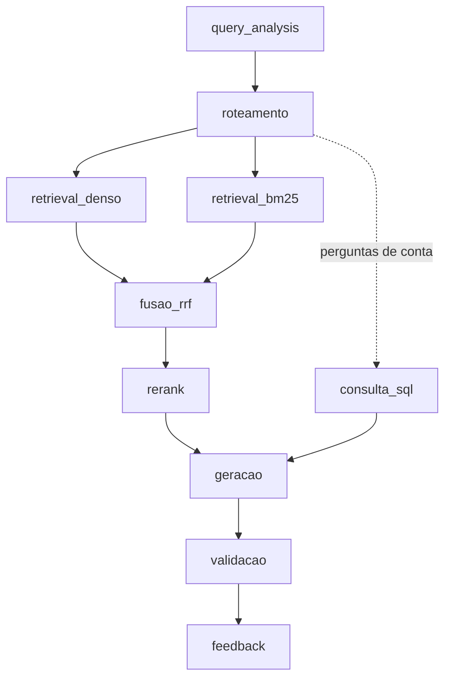

# RAG — Grande Desafio · Cenário 1: Contratações Públicas do RJ

**Residência TIC em Trilhas · PUC-Rio · Instituto ECOA**

Sistema de **Adaptive RAG** sobre contratações públicas do Estado do Rio de Janeiro: dado uma pergunta em linguagem natural, o sistema decide sozinho **onde buscar** (norma, registro estruturado, conversa ou número agregado) antes de buscar, recupera evidência híbrida (densa + BM25 + RRF + rerank) e gera uma resposta citando fontes — ou recusa, quando o caso exige.

O snapshot oficial atual é a **v6**, com 1.400 arquivos nas quatro bases e limite
de cinco arquivos por órgão e por base. São 804 arquivos municipais, 513 federais
e 83 estaduais: uma amostra orientada às personas, sem garantia de censo.
Consulte o [inventário](CORPUS_INVENTORY.md), o
[registro da v6](docs/registro_execucao_v6.md) e o
[fluxo de consulta da v6](docs/CLI.md#snapshot-oficial-v6).
A consulta também inclui o [suplemento sintético conversacional](docs/emails_sinteticos.md):
25 conversas fictícias (45 mensagens), em uma base separada dos dados reais da v6.

Os vetores ativos em `data/embeddings/2026-10-07_21-18-41_ocr-recovery/` (a v6
após a recuperação OCR; a geração original fica em `2026-09-30_12-08-51/`), os índices em `index/`,
os documentos normalizados e o SQLite da v6 estão versionados para consulta.
As credenciais ECOA continuam locais no `.env`. Os arquivos brutos são externos
ao Git; as fontes públicas constam nos metadados. As entregas das atas estão em
[PDF](atas-zip/atas_conversacional-v6.zip) e
[Markdown](atas-zip/atas_conversacional-v6-md.zip), com 40 documentos cada.
Embeddings e ZIP da v5 permanecem no disco, fora destes commits.

## Por que este cenário

Todo órgão público brasileiro publica suas contratações no [PNCP](https://pncp.gov.br) por força da Lei 14.133/2021, mas o portal só permite consulta contrato a contrato — não permite cruzar edital, contrato, ata de registro de preços e valores homologados numa única pergunta. Este projeto constrói essa camada de consulta.

Escolhemos o Cenário 1 por ser o **mais verificável** dos três disponíveis (qualquer resposta pode ser conferida diretamente no portal do PNCP) e por oferecer o melhor contraste entre busca esparsa e densa: número de contrato e CNPJ só aparecem com BM25; "compra de equipamento hospitalar" só aparece com embeddings.

Contexto completo do desafio, dos outros dois cenários e dos padrões de engenharia exigidos está em [GRANDE_DESAFIO_CENARIOS.md](GRANDE_DESAFIO_CENARIOS.md).

## As quatro naturezas de conhecimento

| Base | Natureza | Conteúdo | Fonte | Acesso |
| --- | --- | --- | --- | --- |
| `editais_normativo` | Normativa | Lei 14.133/2021, decretos estaduais, editais de licitação | Senado Federal, REDELOG-RJ, CGE-RJ, MPPI | PDF/HTML por URL |
| `contratos_estruturado` | Estruturada | 625 contratos de órgãos do RJ, quase todos de 2025 (434 municipais, 159 federais, 32 estaduais) | PNCP — API de consulta | REST paginado |
| `atas_conversacional` | Conversacional | 376 arquivos de atas de registro de preços: 336 JSON de metadados e 40 PDFs | PNCP | REST (JSON) + PDF |
| `emails_sinteticos` | Conversacional | Suplemento: 25 conversas fictícias de compras públicas; 20 públicas e 5 restritas | Base sintética gerada pelo tutor | JSON local |
| `pca_agregado` | Agregada | 386 registros relacionados ao planejamento e ao resultado das compras: itens homologados, contratações vinculadas e um PCA confirmado (Secretaria de Saúde estadual) | PNCP | REST (JSON) |

Números da v6 (limite de cinco arquivos por órgão e por base); detalhes em [CORPUS_INVENTORY.md](CORPUS_INVENTORY.md) e em [docs/registro_execucao_v6.md](docs/registro_execucao_v6.md).

A definição declarativa de cada base — fonte, tipo de acesso, volume-alvo, campo de vigência, licença — vive em [corpus_manifest.yaml](corpus_manifest.yaml), que é a fonte única de verdade sobre o que entra no corpus. `data/raw/` nunca é versionado; qualquer pessoa reconstrói o corpus rodando o coletor contra o manifesto.

Só as bases com `escopo: oficial` no manifesto respondem perguntas; as marcadas como `experimental` ficam fora da busca (`ESCOPOS_CONSULTADOS` em [src/pipeline.py](src/pipeline.py)).

**Base agregada.** Quando a base traz o CSV do PCA (um item planejado por linha), a preparação calcula indicadores com [src/pca_indicators.py](src/pca_indicators.py): visão geral, e totais, participação e ranking por categoria, unidade responsável, classe de catálogo e mês. Cada indicador vira **um chunk** com os números já calculados, e assim o LLM cita valores prontos, em vez de tentar somar linhas. Na v6, com o limite por órgão, a base ficou com um único PCA confirmado; os 911 chunks são quase todos registros JSON (itens homologados e contratações vinculadas), com só 2 indicadores. Contas sobre esses registros (soma por fornecedor, ranking, mediana) passam pela etapa `consulta_sql`.

**Base conversacional.** A API de atas do PNCP ignora o filtro `uf`; o recorte do RJ é feito pelo CNPJ do órgão (`cnpjs` no manifesto, o mesmo do PCA). Para cada ata, o coletor baixa o JSON de metadados, a listagem `/arquivos` e cada PDF anunciado nela. Parte desses PDFs é escaneada, sem texto; com o Tesseract instalado, a preparação aplica OCR nessas páginas ([src/ocr.py](src/ocr.py)). Os chunks do PDF herdam da mesma ata a vigência (`dataVigenciaFim`) e o título do documento, que também aparecem para o LLM no cabeçalho de cada trecho — assim ele distingue a ata de uma publicação no Diário Oficial anexada a ela.

**Suplemento sintético conversacional.** `emails_sinteticos` participa das consultas
normais pela natureza conversacional. Apenas os 25 JSONs individuais do ZIP são
importados; as cópias TXT e o JSONL consolidado não duplicam a base. Cada conversa
preserva suas mensagens e classificação de sensibilidade. Cinco conversas com
credenciais/dados bancários são restritas e não chegam ao LLM; CPF, telefone e
e-mail pessoal das demais são mascarados. Texto e cabeçalho identificam o conteúdo
como **sintético**, que não pode comprovar fatos reais do PNCP. Reimportação e
proveniência em [docs/emails_sinteticos.md](docs/emails_sinteticos.md).

> A API do PNCP **não tem busca textual**. Filtro por objeto é feito localmente, e o recorte de dados é sempre determinístico (mesmo manifesto ⇒ mesmo corpus).

## Roteamento adaptativo — a ideia central

A pergunta que o roteador responde não é "sobre o que o usuário falou", e sim "que tipo de evidência responde isso". Três perguntas quase idênticas em vocabulário podem exigir três rotas distintas:

- *"Qual foi o valor médio por quilo de arroz contratado por municípios do RJ em 2025?"* → agregada + estruturada.
- *"Quais contratos de licenciamento de software foram assinados acima de R$ 500 mil em 2025?"* → estruturada, com filtro numérico extraído da pergunta.
- *"Sou MEI, posso participar de pregão eletrônico? Tem algum aberto pra material de escritório?"* → normativa (tratamento a ME/EPP) **e** estruturada (contratações em aberto) na mesma pergunta.

As seis personas de referência, com as 18 perguntas classificadas por rota esperada e tipo (mais uma pergunta de falha esperada), estão em [PERSONAS.md](PERSONAS.md) — e viraram o golden set que `eval/run_eval.py` roda contra o pipeline. `src/router.py` já implementa esse roteamento de forma determinística (regex sobre o texto normalizado da pergunta, sem chamar o LLM).

## Política de sensibilidade

Classificação feita na **ingestão** (metadado `sensitivity` em cada chunk), nunca delegada ao LLM na hora de responder:

- **Responder:** valores de contrato, nome de empresa fornecedora, CNPJ de pessoa jurídica, objeto contratado — público por lei.
- **Mascarar:** CPF de pessoa física contratada, telefone e e-mail pessoal de servidor que aparecem em atas.
- **Recusar:** dados bancários de fornecedor, credenciais vazadas em e-mail, juízo sobre a legalidade de um contrato específico (o sistema apresenta dados, não acusa). Ver `RefusalReason` em [src/schema.py](src/schema.py).

Como é aplicada ([src/sensitivity.py](src/sensitivity.py), chamado por [src/generate.py](src/generate.py)):

- **Mascaramento determinístico (regex), em dois pontos:** no contexto antes do prompt (o LLM nunca vê o dado) e na resposta final (caso o dado venha da própria pergunta). CPF formatado é sempre mascarado; CPF só com dígitos e telefone sem DDD entre parênteses/`+55` só quando rotulados (`CPF:`, `Tel.:`), para não mascarar ids de processo. E-mails de domínio institucional (`.gov.br`, `.jus.br`, `.mp.br`, `.leg.br`, `.def.br`, `.mil.br`) são preservados; os demais viram `[e-mail omitido]`. CNPJ não é tocado.
- **Chunks `sensitivity=restrito` são descartados** antes da geração; se só sobrarem restritos, a resposta é recusa `sem_evidencia`.
- O log de geração registra quantos dados foram mascarados por tipo (`mascaramentos`) e quantos chunks restritos foram descartados — nunca o valor original.
- Testes em [tests/test_sensitivity.py](tests/test_sensitivity.py).

## Pipeline



O diagrama mostra os caminhos possíveis: em uma pergunta puramente analítica,
SQL suficiente vai direto à geração determinística, sem executar a recuperação
ou carregar o reranker. Se o cálculo falhar ou for insuficiente, a busca permanece
como fallback; perguntas mistas preservam as evidências das outras bases.

Estágios de consulta (nomes fixos no campo `stage`): `interacao`, `reformulacao`, `query_analysis`, `roteamento`, `retrieval_denso`, `retrieval_bm25`, `fusao_rrf`, `rerank`, `consulta_sql`, `geracao`, `validacao`, `feedback` e `resumo_consulta`. Envelopes: `pipeline_inicio`, `pipeline_fim`, `requisicao_inicio`, `requisicao_fim` e `persistencia_historico`. Operações offline usam `coleta`, `inventario`, `ingestao`, `preparacao`, `embeddings`, `indexacao` e `embedding_lote`, no mesmo JSONL. Detalhes de decisão e divisão de responsabilidades em [ARQUITETURA.md](ARQUITETURA.md); contrato dos logs em [docs/OBSERVABILIDADE.md](docs/OBSERVABILIDADE.md).

**Implementado:**

- `query_analysis` ([src/query_analysis.py](src/query_analysis.py)): extrai da pergunta, sem LLM, filtros de ano, valor (mínimo, máximo, faixa) e órgão.
- `roteamento` ([src/router.py](src/router.py)): escolhe as bases antes de buscar.
- `retrieval_denso` / `retrieval_bm25` / `fusao_rrf` ([src/retrieve.py](src/retrieve.py)): busca híbrida com filtros de metadado. Os filtros são aplicados base a base: numa base sem o campo filtrado, ou em que o filtro excluiria todos os chunks, ele é ignorado e o log registra isso em `extra.filtros_ignorados`. Se ainda assim os filtros zerarem o resultado, [src/pipeline.py](src/pipeline.py) refaz a busca sem eles.
- `rerank` ([src/rerank.py](src/rerank.py)): um cross-encoder local (`RERANK_MODEL`, padrão `cross-encoder/mmarco-mMiniLMv2-L12-H384-v1`, roda em CPU) reordena os `RERANK_CANDIDATES` (padrão 10) primeiros do RRF. Chunks JSON vão para o modelo com os campos de conteúdo primeiro (`objetoCompra`, título, órgão...), porque o modelo só lê 512 tokens. Se o modelo falhar, o log registra erro e o resultado volta a ser o do RRF. O `retrieve` aplica o reranker que receber; `reranker_padrao()` devolve o cross-encoder, ou `None` com `RERANK_ENABLED=false`. O `responder` ([src/pipeline.py](src/pipeline.py)) usa o `reranker_padrao()` quando nenhum reranker é passado. Na ablação no corpus v6 (47 perguntas rotuladas, 13 delas de identificador como CNPJ e número de contrato), o hit@3 sobe de 0,64 (só RRF) para 0,83 com o rerank, a melhor configuração medida; o denso sozinho não acha identificadores (0,31) e o BM25 sozinho erra as perguntas parafraseadas: ver [docs/ABLACAO_RERANK.md](docs/ABLACAO_RERANK.md). Na primeira execução o modelo (~470 MB) é baixado para o cache do Hugging Face.
- `consulta_sql` ([src/structured_query.py](src/structured_query.py) + [src/structured_db.py](src/structured_db.py)): perguntas de conta sobre as bases estruturada e agregada (ranking, estatística com média e mediana, comparação entre esferas, evolução no tempo, agrupamento) são respondidas por uma consulta SQL pré-escrita e parametrizada — o LLM nunca escreve SQL. O resultado entra como chunk (`doc_type="sql"`, `chunk_id` começando com `sql:`) antes dos chunks da busca. Perguntas exclusivamente analíticas tentam SQL primeiro: com cálculo suficiente, pulam busca densa/BM25/RRF/rerank e são renderizadas diretamente desses resultados, sem LLM alterar os números; perguntas mistas mantêm a recuperação e a geração normal. Totais incluem zeros/centavos registrados, enquanto média/mediana e extremos informativos são qualificados para valores >= R$ 1,00. Validação real CLI/frontend e valores conferidos no bruto em [docs/NUMERICAL_VALIDATION.md](docs/NUMERICAL_VALIDATION.md). Se o termo pedido não existe no objeto de nenhuma contratação, o resultado diz isso em vez de calcular sobre outro assunto. Falha no banco é registrada no log e a resposta segue só com a busca.
- `geracao` ([src/generate.py](src/generate.py)): guardrails determinísticos antes do LLM, prompt limitado à janela do modelo (`GENERATION_CONTEXT_CHARS` no total e `GENERATION_CHUNK_CHARS` por chunk; o log registra `chunks_no_prompt` e `chunks_fora_do_orcamento`) e saída pedida em JSON (`response_format`).
- `validacao` ([src/generate.py](src/generate.py)): checa a saída do LLM. JSON inválido vira recusa segura, citação de chunk que não foi recuperado é descartada (`extra.citacoes_descartadas`) e dado pessoal na resposta é mascarado.

[src/pipeline.py](src/pipeline.py) une as etapas numa única função (`responder`).

`feedback` ([src/history_store.py](src/history_store.py)): toda chamada a `POST /api/v1/query` recebe um `query_id` e é salva (pergunta + resposta completa) num SQLite local (`data/app_state/historico.sqlite`, fora do Git — diferente da base derivada de `structured_db.py`, este é estado da aplicação e não é remontado). `POST /api/v1/feedback` associa uma avaliação (`positivo`/`negativo` + comentário opcional) a um `query_id` já registrado (404 se não existir) e grava o evento no log estruturado com `stage="feedback"`. `GET /api/v1/history?limit=N` devolve as consultas mais recentes com o feedback recebido (`&session_id=...` restringe a uma conversa). O histórico geral está temporariamente aberto para a demo, sem chave, e pode mostrar consultas de todos os usuários; não exponha conteúdo sensível. O filtro `session_id` não é autenticação. O trace continua protegido: aceita `X-API-Key` igual a `RAG_API_KEY` ou o header `X-Session-Id` da própria conversa, para o usuário ver o caminho das suas perguntas sem chave no site; o histórico grava os textos mascarados e apaga consultas com mais de `HISTORY_RETENTION_DAYS` dias (padrão 30). Testes em [tests/test_history_store.py](tests/test_history_store.py) e [tests/test_app_api.py](tests/test_app_api.py).

O parsing da geração aceita as variações de chave que o modelo da turma produz na prática (`sources` em vez de `sources_used`, `confidence` numérico em vez de `confidence_level`) e registra no log, em `extra.chaves_fora_do_contrato`, quando isso acontece. Toda etapa registra log estruturado via [src/obs.py](src/obs.py) (JSONL em `logs/pipeline/pipeline-AAAA-MM-DD.jsonl`, com `run_id`, `stage`, latência e tokens). A retenção acompanha `HISTORY_RETENTION_DAYS` por padrão (30 dias); `LOG_RETENTION_DAYS=0` desliga o expurgo. Diagnósticos ficam em `logs/maintenance/`, backups em `data/backups/` e temporários de testes em `.tmp/tests/`. `python -m src.log_maintenance cleanup` mostra o plano de expurgo; somente `--apply` o executa. Diagnósticos concluídos e testes falhos seguem `MAINTENANCE_RETENTION_DAYS` (14 dias); backups nunca são expurgados automaticamente.

Cada chamada a `responder` abre `pipeline_inicio` e fecha `pipeline_fim`, mesmo quando há exceção. A API envolve esse caminho em `requisicao_inicio`/`requisicao_fim` e registra `persistencia_historico`, com HTTP status e `history_saved`. Os stages internos continuam correlacionados por `run_id`, `query_id` e `session_id`; etapas não executadas ficam explícitas como `pulado`, e fallbacks tratados como `degradado`. `extra.schema_version=2` identifica origem, sequência, resultado normalizado e tentativas/intenção. Os envelopes trazem fingerprints de código/índice e configuração permitida; SQL registra tentativas e parâmetros mascarados; a geração registra prompt, evidências e resposta. `resumo_consulta` distingue consulta tentada de evidência retornada.

Coleta, preparação, embeddings e indexação também emitem o contrato comum, com `origem=offline` e IDs de correlação próprios. A coleta preserva o log legado em `data/runs/`; relatórios e artefatos existentes não mudam. `extra.uso_tokens` distingue uso reportado, parcial, desconhecido, cache e ausência de chamada. `chamadas_modelo` observa chamadas SDK e fallbacks; retries HTTP internos ficam explicitamente não observados, sem inventar consumo. `interacao` e `reformulacao` registram o modelo efetivo. O subdiretório `logs/pipeline/` foi mantido por decisão do projeto, apesar do caminho de raiz exemplificado no enunciado.

A escrita usa fila limitada e lotes, coordenados entre processos por SQLite/WAL local; JSONL continua sendo a fonte de verdade. Um índice derivado (`logs/pipeline/pipeline-index.sqlite`) permite consultar traces sem reler todo o conteúdo dos logs; importação legada é incremental. `LOG_EVIDENCE_DETAIL=resumo` é o padrão; `completo` acrescenta todas as evidências retornadas, resultados SQL e prompt mascarados, sem aumentar o contexto do LLM.

`GET /api/v1/trace/{query_id}` e `GET /api/v1/sessions/{session_id}/trace` continuam compatíveis com logs antigos. O tempo total vem do envelope monotônico, não da soma de etapas sobrepostas; traces novos indicam `completo`, `status` e `latencia_metodo`. Feedback posterior não aumenta a duração da consulta. Textos têm limites explícitos e dados pessoais são mascarados também em `extra`. Falha de I/O no logger não derruba a resposta. Testes isolam tanto logs quanto histórico da API ([tests/conftest.py](tests/conftest.py)), sem escrever em dados reais. Contrato, exemplos e limites em [docs/OBSERVABILIDADE.md](docs/OBSERVABILIDADE.md) e [docs/FRONTEND_API_CONTRACT.md](docs/FRONTEND_API_CONTRACT.md).

## Estrutura do repositório

```
├── acompanhamento/              ← relato individual + resumo do dia, a cada encontro
├── docs/                         ← guia da interface CLI e capturas de tela
├── CORPUS_INVENTORY.md           ← inventário legível do corpus coletado
├── data/
│   ├── raw/vN/                  ← versão imutável de cada coleta (staging em raw/.staging/ até promoção)
│   ├── normalized/              ← chunks normalizados (JSONL), saída de src/prepare_documents.py (o snapshot da v6 está versionado; novas saídas continuam ignoradas)
│   ├── embeddings/               ← embeddings versionados (cache + partes), gerados por src/create_embeddings.py
│   ├── inventory/                ← inventário por versão (JSON), checkpoints e diffs entre versões
│   ├── runs/                    ← relatórios de execução de cada coleta
│   └── attempts/                ← coletas e preparações experimentais (--data-root), fora do Git
├── index/                       ← índice vetorial por base (vectors.jsonl + vectors.faiss); o índice da v6 está versionado
├── logs/                        ← pipeline/ (JSONL diário) e maintenance/ (diagnósticos), fora do Git
├── eval/                        ← golden set das personas e harness de avaliação (run_eval.py)
├── tests/fixtures/               ← amostras locais para testes offline
├── tests/                       ← testes de contrato (pytest), offline
├── app/
│   ├── cli.py                   ← interface de linha de comando: rota e resposta completa do pipeline
│   └── api.py                   ← API HTTP (FastAPI): /health, /api/v1/query, /api/v1/feedback, /api/v1/history, /api/v1/trace
├── src/
│   ├── fetch_corpus.py          ← coleta determinística e versionada do corpus
│   ├── providers/               ← provedores declarativos de fontes (pncp.py: contratações, atas + PDFs, PCA)
│   ├── pncp_client.py           ← cliente HTTP do PNCP com tentativas e timeout
│   ├── artifact_downloader.py   ← download de arquivos (PDF/HTML/CSV) com detecção de formato e deduplicação por SHA-256
│   ├── retry.py                 ← espera entre tentativas HTTP (Retry-After do servidor ou backoff exponencial)
│   ├── ssl_context.py           ← certificados HTTPS: os do sistema somados ao bundle do certifi
│   ├── corpus_validator.py      ← validação do inventário contra o manifesto
│   ├── source_catalog.py        ← curadoria das fontes (subcomandos discover, lookup, propose)
│   ├── manifest_curator.py      ← descoberta e propostas para o manifesto
│   ├── source_lookup.py         ← busca remota nas fontes suportadas
│   ├── corpus_search.py         ← busca local no inventário
│   ├── ingest.py                ← fachada compatível; delega a extração para prepare_documents.py
│   ├── prepare_documents.py     ← extração por formato (PDF/HTML/CSV/JSON/JSONL), chunking e metadados canônicos
│   ├── pca_indicators.py        ← indicadores agregados do PCA (1 indicador = 1 chunk) para a base agregada
│   ├── ocr.py                   ← OCR (Tesseract) das páginas de PDF escaneadas, usado por prepare_documents.py
│   ├── qualidade_corpus.py      ← controle de qualidade do normalizado: texto ilegível, vigência das normas, contrato↔compra, valor simbólico
│   ├── create_embeddings.py     ← embeddings com cache, multi-provedor e escrita incremental
│   ├── index.py                 ← índice vetorial por base; gera embeddings ou reaproveita os de data/embeddings/
│   ├── query_analysis.py        ← extrai filtros de ano, valor e órgão da pergunta
│   ├── structured_db.py         ← base estruturada em SQL (Postgres/Neon ou SQLite): tabelas contratacoes e pca_planos
│   ├── structured_query.py      ← consultas SQL fixas (ranking, estatística, evolução, agrupamento) como evidência
│   ├── router.py                ← roteamento determinístico (Adaptive RAG)
│   ├── retrieve.py              ← recuperação híbrida: denso + BM25 + RRF, filtros de metadado por base, rerank plugável
│   ├── rerank.py                ← rerank por cross-encoder local sobre os candidatos do RRF
│   ├── generate.py              ← geração com guardrails, prompt na janela do modelo e validação da saída do LLM
│   ├── sensitivity.py           ← política de sensibilidade: mascaramento de CPF/telefone/e-mail e filtro de restritos
│   ├── pipeline.py              ← une query_analysis + roteamento + recuperação + geração numa função (responder)
│   ├── history_store.py         ← histórico de consultas e feedback do usuário (SQLite local, data/app_state/)
│   ├── obs.py                   ← logging estruturado (JSONL) e contagem de tokens
│   ├── log_store.py             ← fila, append coordenado e índice SQLite/WAL de traces
│   ├── log_evidence.py          ← auditoria completa opcional de evidências mascaradas
│   ├── offline_observation.py   ← contrato JSONL e correlação para operações offline
│   ├── model_observation.py     ← chamadas SDK, uso disponível e cobertura de tentativas
│   ├── trace.py                 ← caminho de uma pergunta ou de uma sessão, montado a partir do log
│   └── schema.py                ← modelos Pydantic (chunk, roteamento, resposta, recusa)
├── llm_ecoa.py                  ← exemplo mínimo de geração e embedding via endpoint compartilhado
├── corpus_manifest.yaml         ← o que entra no corpus (fonte única de verdade)
├── ARQUITETURA.md               ← pipeline, estágios e divisão de responsabilidades
├── PERSONAS.md                  ← personas e perguntas de referência
└── .env.example                 ← variáveis necessárias, sem valores reais
```

## Como rodar

O guia visual da interface de coleta, curadoria e busca está em
[docs/README.md](docs/README.md), com exemplos de comandos e capturas de tela
da CLI.

**1. Configurar ambiente**

```bash
python -m venv .venv
.venv\Scripts\activate          # Windows
pip install -r requirements-lock.txt
copy .env.example .env          # preencher se necessário; os defaults já apontam para o endpoint da turma
```

O [requirements-lock.txt](requirements-lock.txt) fixa a versão exata de cada pacote, a mesma usada no CI, e instala o torch só de CPU. O [requirements.txt](requirements.txt) continua com as faixas de versão aceitas: ao mudá-lo, gere o lock de novo com o comando do cabeçalho do lock.

Opcional: para ler as atas escaneadas, instale o Tesseract com o idioma português (passo a passo em [docs/CLI.md](docs/CLI.md#ocr-de-pdfs-escaneados-opcional)). Sem ele, tudo funciona, mas as páginas escaneadas ficam sem texto.

No Windows, coletas em pastas com nome longo podem passar do limite de 260 caracteres de caminho (`FileNotFoundError: [WinError 3]`). Ative o suporte a caminhos longos, no PowerShell como administrador:

```powershell
Set-ItemProperty 'HKLM:\SYSTEM\CurrentControlSet\Control\FileSystem' -Name LongPathsEnabled -Value 1
```

**2. Coletar o corpus** (materializa versões imutáveis a partir do manifesto)

```bash
py -m src.fetch_corpus fetch --manifest corpus_manifest.yaml --official
py -m src.fetch_corpus update --manifest corpus_manifest.yaml --official
py -m src.fetch_corpus inventory --corpus-version v2 --official
```

**Curar novas fontes antes da coleta**

`source_catalog` pode descobrir fontes e gerar propostas sem alterar o
manifesto. A incorporação oficial exige revisão e `apply`, que valida o hash
do manifesto antes de escrever:

```bash
py -m src.source_catalog discover
py -m src.source_catalog lookup pncp --query "contratação software" --uf RJ --year 2025
py -m src.source_catalog propose --manifest corpus_manifest.yaml
py -m src.source_catalog manifest-diff --manifest corpus_manifest.yaml --proposal data/proposals/manifest-proposal-AAAA.json
py -m src.source_catalog review --proposal data/proposals/manifest-proposal-AAAA.json
py -m src.source_catalog apply --manifest corpus_manifest.yaml --proposal data/proposals/manifest-proposal-AAAA-reviewed.json
```

O comando `apply` é o único dessa interface que altera o manifesto. Depois da
revisão, use `fetch` ou `update` para materializar a definição aprovada.

`lookup` pesquisa uma fonte remota suportada, mas não incorpora resultados ao
corpus automaticamente. Para pesquisar o que já foi coletado, use o inventário:

```bash
py -m src.corpus_search search local \
  --corpus-version v1 \
  --query "edital 90012" \
  --base-id documentos_pncp
```

Essa busca inicial consulta apenas metadados (`logical_id`, base, origem,
caminho, tipo e hash); ela não faz busca textual dentro de PDFs.

Para inspecionar um update sem rede nem escrita:

```bash
py -m src.fetch_corpus update --manifest corpus_manifest.yaml --official --dry-run
```

Use `--official` somente para operar a árvore principal `data/`. Sem essa
flag, a execução é experimental e exige um `--data-root` separado. Cada
tentativa terá seu próprio `raw/`, `inventory/`, `runs/` e
`CORPUS_INVENTORY.md`:

```bash
py -m src.fetch_corpus fetch --manifest corpus_manifest.yaml --data-root data/attempts/corpus_fetch/tentativa-v5
py -m src.fetch_corpus update --manifest corpus_manifest.yaml --data-root data/attempts/corpus_fetch/tentativa-v5
py -m src.fetch_corpus inventory --corpus-version v1 --data-root data/attempts/corpus_fetch/tentativa-v5
```

O diretório `data/attempts/` é experimental e fica fora do Git; ele não
substitui as versões oficiais em `data/raw/` e `data/inventory/`.

Para uma verificação rápida após clonar o repositório, há 20 PDFs pequenos em
`tests/fixtures/pdf/`. A base `exemplos_teste` está declarada no manifesto
principal e pode ser executada em uma área experimental:

```bash
py -m src.fetch_corpus fetch `
  --manifest corpus_manifest.yaml `
  --data-root data/attempts/corpus_fetch/demo `
  --base-id exemplos_teste

pytest tests/ -m "not llm"
pytest tests/test_fetch_corpus.py -q
```

Os PDFs são amostras de entrada para inspeção e testes locais. A base usa
`arquivo_local`, não faz requisições externas e só entra no corpus quando o
comando é executado; usando `--data-root`, a execução não altera `data/raw/`.

**3. Preparar documentos e PDFs** (extrai formatos, organiza metadados e grava chunks JSONL)

```bash
py -m src.prepare_documents `
  --input tests/fixtures/pdf `
  --manifest corpus_manifest.yaml `
  --base-id exemplos_teste `
  --output data/attempts/corpus_fetch/demo/normalized/documents.jsonl `
  --report data/attempts/corpus_fetch/demo/normalized/extraction_report.json

py -m src.prepare_documents `
  --input tests/fixtures/pdf `
  --manifest corpus_manifest.yaml `
  --base-id exemplos_teste `
  --dry-run
```

Para preparar uma base de uma coleta já registrada, informe o inventário
correspondente. O preparador usa `base_id + SHA-256` para recuperar a origem e o
horário real de coleta de cada arquivo, e usa a `source_ref` do inventário para
que o PDF de uma ata herde a vigência e o título do documento registrados nos
JSONs da mesma ata. Para sempre usar a versão completa mais recente, informe
`--latest` e o `--base-id`; nesse modo, o inventário é selecionado
automaticamente:

```bash
py -m src.prepare_documents `
  --latest `
  --base-id contratos_estruturado `
  --manifest corpus_manifest.yaml
```

A saída fica em `data/normalized/vN/contratos_estruturado/`, onde `vN`
corresponde à versão indicada no resumo e no relatório da execução. Para
reproduzir uma versão histórica, informe manualmente o inventário e os arquivos
brutos dessa mesma versão.

O script separado trata PDF, HTML, TXT, Markdown, CSV, JSON e JSONL. O
chunking é adaptativo conforme `chunking_sugerido` do manifesto: registros
estruturados permanecem inteiros, enquanto documentos normativos são divididos
por cláusulas/artigos quando esses cabeçalhos existem, usando o chunking
genérico como fallback. Cada chunk preserva `source_file`, `chunk_id`,
`parent_chunk_id`, `base_id`, `natureza`, `doc_type` (formato original), `sensitivity`,
SHA-256, página, vigência e proveniência no manifesto. Páginas de PDF sem texto
passam por OCR quando o Tesseract está instalado (`status_extracao: ok_ocr` no
relatório; sem OCR, `sem_texto`). `src/ingest.py` mantém uma fachada compatível
para esse mesmo fluxo oficial.

A base opcional `licitacoes_siga_csv` usa o CSV público da SEPLAG-RJ. O parser
detecta o delimitador publicado, preserva os nomes reais das colunas e cria um
chunk por licitação. A amostra versionada em `tests/fixtures/formats/` contém
50 linhas reais para testes rápidos; a URL do manifesto permite reconstruir o
arquivo completo.

**4. Criar embeddings com cache**

Primeiro valide sem chamar o endpoint:

```bash
py -m src.create_embeddings `
  --input data/attempts/corpus_fetch/demo/normalized/documents.jsonl `
  --output data/attempts/corpus_fetch/demo/embeddings/embeddings.jsonl `
  --dry-run
```

Com o endpoint configurado, remova `--dry-run`. O padrão usa lotes de 64,
pausa de 10 segundos entre chamadas e partes de até 45 MiB, seguindo a mesma
estratégia de persistência incremental da inspiração:

```bash
py -m src.create_embeddings `
  --input data/attempts/corpus_fetch/demo/normalized/documents.jsonl `
  --output data/attempts/corpus_fetch/demo/embeddings/embeddings.jsonl
```

O cache é indexado pelo SHA-256 do conteúdo e por uma impressão digital dos
metadados semânticos do chunk. Textos idênticos podem ser reutilizados quando
pertencem ao mesmo contexto; alterações em `base_id`, natureza, origem,
manifesto, vigência ou sensibilidade invalidam o embedding anterior. A
execução deixa, no mesmo diretório, `embeddings.part-0001.jsonl` (partes
atômicas) e `embedding_report.json` (estatísticas). Se o processo for
interrompido, a execução seguinte reutiliza somente registros compatíveis.

O diretório `data/embeddings/` fica versionável, como na inspiração. A
materialização pública atual está em
[`data/embeddings/embeddings.jsonl`](data/embeddings/embeddings.jsonl), com o
relatório em [`data/embeddings/embedding_report.json`](data/embeddings/embedding_report.json).
Assim, o professor pode testar a leitura e a indexação diretamente após clonar
o repositório. Novas execuções de desenvolvimento devem usar
`data/attempts/`, que continua fora do Git.

As opções de provedor são `ecoa`, `ollama`, `openai` e `custom`. O cache registra
provedor, endpoint e modelo para impedir a mistura de espaços vetoriais
diferentes.

Antes do índice, `src/qualidade_corpus.py` faz o controle de qualidade dos
JSONL de `data/normalized/` (o da raiz, o combinado da v6 e os da v6 por base).
Ele não muda o texto dos chunks, só status e metadados, então os vetores
continuam valendo:

- chunk de PDF sem mapa de caracteres (`/12 /3 □` ou `/U0044/U0049`) recebe
  `status_extracao: "texto_ilegivel"` e fica fora do índice;
- as normas recebem número, publicação e início da vigência
  (`extras.data_vigencia_inicio`), declarados no manifesto em
  `metadados_por_url`; editais e termos de referência do PNCP recebem a data de
  publicação da compra vinculada;
- o contrato herda a modalidade da compra da mesma contratação
  (`numero_controle_compra`), e a compra, o fornecedor do contrato;
- valor abaixo de R$ 1,00 recebe `extras.valor_simbolico: true`.

O relatório fica em [`data/inventory/qualidade_v6.json`](data/inventory/qualidade_v6.json).

```bash
py -m src.qualidade_corpus --verificar   # só conta, sem gravar
py -m src.qualidade_corpus               # aplica e grava o relatório
```

`src/index.py` monta o índice usado pela busca: particiona por `base_id`, grava
os metadados/vetores em `vectors.jsonl` e persiste um índice FAISS em
`vectors.faiss` para a recuperação densa. Depois de atualizar os documentos ou
o modelo de embeddings, rode esse comando novamente para reconstruir os
índices. `src.create_embeddings` continua disponível para gerar artefatos com
cache, mas a recuperação em `src.retrieve` lê os índices criados por `src.index`.

```bash
py .\src\index.py --dry-run     # só conta chunks por base, sem chamar o modelo de embeddings
py .\src\index.py               # gera embeddings de verdade, via o endpoint compartilhado
```

Chunks sem texto e chunks com `status_extracao: "texto_ilegivel"` ficam fora
do índice; o manifesto de cada base conta os ilegíveis em
`chunks_ilegiveis_ignorados`. Para refazer o índice da v6 depois do controle de
qualidade, sem gerar vetores, reaproveite os vetores da v6 base a base:

```powershell
foreach ($base in "atas_conversacional", "contratos_estruturado", "editais_normativo", "pca_agregado") {
  py .\src\index.py --input "data\normalized\v6\$base\documents.jsonl" --output index `
    --embeddings "data\embeddings\2026-10-07_21-18-41_ocr-recovery\$base\embeddings.jsonl" --merge-existing
}
```

`--embeddings` reaproveita vetores já publicados em vez de chamar o modelo; cada
chunk é localizado pelo SHA-256 do texto, então só entra texto idêntico ao que
gerou o vetor. O `data/embeddings/embeddings.jsonl` versionado não traz o texto
dos chunks; para montar um índice de desenvolvimento a partir dele, prepare de
novo os PDFs de `tests/fixtures/pdf/` (base `exemplos_teste`, 446 chunks):

```bash
py -m src.prepare_documents --input tests/fixtures/pdf --manifest corpus_manifest.yaml --base-id exemplos_teste --output data/attempts/exemplos_teste/documents.jsonl
py .\src\index.py --input data/attempts/exemplos_teste/documents.jsonl --output data/attempts/exemplos_teste/index --embeddings data/embeddings/embeddings.jsonl
```

> **Atenção:** não use `--output data/normalized/documents.jsonl` nem o
> `--output` padrão do `index.py` (`index/`) para a base `exemplos_teste`. O
> `retrieve.py` busca o texto dos chunks em `data/normalized/documents.jsonl`;
> sobrescrever esse arquivo com só os exemplos deixa as bases oficiais sem
> texto, e o pipeline passa a recusar todas as perguntas. Da mesma forma,
> indexar só os exemplos em `index/` reescreve o `index/manifest.json` global.

**4.1 Base estruturada em SQL**

A base SQL é montada a partir de `data/normalized/documents.jsonl` (registros JSON de `contratos_estruturado` e `pca_agregado`) e se remonta sozinha na primeira pergunta de conta depois que esse arquivo muda. Para montar ou consultar à mão:

```bash
py -m src.structured_db build
py -m src.structured_db sql "SELECT modalidade, COUNT(*) AS n FROM contratacoes GROUP BY modalidade ORDER BY n DESC"
```

Onde a base fica depende de `DATABASE_URL` no `.env` — o mesmo código e o mesmo SQL valem para os dois:

- **Preenchido:** Postgres no [Neon](https://neon.tech) (`postgresql://...?sslmode=require`). É a base do projeto. A connection string tem senha: fica só no `.env`, nunca no repositório nem no log (o log mostra só o host). Com o usuário dono, a base se remonta sozinha quando o `documents.jsonl` ou o esquema mudam; com um usuário só de leitura (`rag_leitor`), ela é usada como está e o log da etapa `consulta_sql` marca `base_desatualizada` — quem tem o usuário dono roda `py -m src.structured_db build` uma vez.
- **Vazio:** SQLite em `data/structured/base_estruturada.sqlite`, versionado no Git com o snapshot v6. Serve a quem não tem a connection string do Neon, aos testes (que sempre usam SQLite temporário, sem internet nem senha; ver `tests/conftest.py`) e às avaliações reproduzíveis. Quando o esquema muda, o arquivo remontado entra no commit, para ninguém ficar com ele alterado.

Tabelas: `contratacoes` e `pca_planos`. Em `contratacoes`, cada linha é uma compra publicada ou um contrato assinado do PNCP: órgão, esfera, município, objeto, modalidade (só as compras trazem), fornecedor (só os contratos trazem) e valor (`valorGlobal` no contrato; homologado, ou estimado, na compra). O contrato guarda o número da compra que o originou (`numero_controle_compra`), e as perguntas sobre "contratações" contam uma vez a contratação que tem os dois registros. Valores abaixo de R$ 1,00 (R$ 0,00 e R$ 0,01 simbólicos do PNCP) ficam fora de média, mediana e ranking. `pca_planos` tem um plano de contratações anual por unidade, com valor total e quantidade de itens. Só entram registros da base agregada cujo número de controle PNCP é de plano (`CNPJ-0-…/ano`): a base traz também compras (`-1-`) e contratos (`-2-`) ligados aos planos, que não são planos (na v6, 1 plano entre 377 registros). Essas compras e contratos vão para `contratacoes` quando a base de contratos não os tem, são do RJ e foram publicados num ano que ela já cobre: na v6, 184 registros, e a tabela passa de 625 para 809 linhas, todas do RJ publicadas em 2025. São só os planos presentes no corpus — o total oficial do PCA do Estado está nos indicadores da base agregada, e o resultado SQL avisa isso.

**5. Testar o endpoint de LLM/embeddings compartilhado**

```bash
python llm_ecoa.py
```

**6. Rodar os testes**

```bash
pytest tests/ -m "not llm"      # camadas unitária e de contrato, offline
```

O GitHub Actions roda esse mesmo comando a cada push e pull request ([.github/workflows/tests.yml](.github/workflows/tests.yml)), com Python 3.14 e as dependências do lock.

**7. Fazer perguntas ao sistema (app)**

```bash
py app/cli.py rota "Sou MEI, posso participar de pregão eletrônico?"       # só mostra as bases escolhidas pelo roteador
py app/cli.py perguntar "Quais contratos de ambulâncias foram publicados?"  # pipeline completo, resposta em JSON
py app/cli.py perguntar "Pergunta 1?" "Pergunta 2?"                       # várias perguntas de uma vez
py app/cli.py perguntar                                                    # sem argumento, pede a pergunta no terminal
```

`perguntar` chama `src.pipeline:responder`, então a resposta já passa pelas recusas, pelo mascaramento de dados pessoais e pelo log de cada etapa. Sem índice montado (`index/`), a resposta é uma recusa `sem_evidencia`. Por padrão só as bases oficiais são consultadas; `--incluir-experimentais` busca também nas experimentais, como o índice de desenvolvimento de `exemplos_teste`:

```bash
py app/cli.py perguntar --incluir-experimentais "Quais sanções a norma prevê para o fornecedor que não recolher a multa?"
```

Com o endpoint compartilhado, a maior parte do tempo é a geração: na última rodada do golden set a resposta completa levou 23 s na mediana e 35 s na média, com picos acima de 3 minutos quando o servidor está carregado (a geração tem limite de `GENERATION_TIMEOUT=180` s e uma nova tentativa). Na primeira pergunta de um processo, o rerank leva ~15 s a mais para carregar o modelo.

**8. Rodar a avaliação (golden set das personas)**

```bash
py .\eval\run_eval.py check                                     # valida o golden set, sem pipeline
py .\eval\run_eval.py run --pipeline eval.adapters:rota_apenas   # só roteamento (src/router.py), rápido e offline
py .\eval\run_eval.py run --pipeline src.pipeline:responder      # pipeline completo: roteamento + recuperação + geração
py .\eval\run_eval.py run --pipeline src.pipeline:responder_incluindo_experimentais   # idem, incluindo bases experimentais
py .\eval\run_eval.py run --pipeline eval.adapters:pipeline_completo   # pipeline completo + tokens e latência por etapa (lidos do log)
py .\eval\run_eval.py run --pipeline eval.adapters:pipeline_completo --ids P1.1 G1   # só alguns casos
py .\eval\ablacao_rerank.py --candidatos 10 30                 # ablação da recuperação: denso, BM25, RRF, RRF + rerank
```

`eval/adapters.py:rota_apenas` avalia só o estágio de roteamento, sem chamar o LLM — útil para checar regressão rápida. `src/pipeline.py:responder` roda o pipeline completo (roteamento + recuperação híbrida via `retrieve.py` + geração via `generate.py`), chamando o LLM de verdade a cada pergunta do golden set.

O relatório (`eval/runs/<run_id>/REPORT.md`) traz rota e recusa (o que define o acerto), citação, confiança, latência e tokens, e o texto de cada resposta. Um caso que dá erro aparece como ERRO sem interromper a rodada. Na rodada `golden-v6-final` (corpus v6, rerank ligado) foram 22/22 em rota e recusa e citação em 21/22; esse número não mede se o conteúdo da resposta está certo, porque o golden set ainda não tem gabarito de conteúdo. Os casos `G1`–`G3` testam os guardrails do cenário (dados bancários, credenciais em e-mail, juízo de fraude). A ablação do rerank usa outro conjunto, [eval/retrieval_set.jsonl](eval/retrieval_set.jsonl), com o trecho relevante de cada pergunta rotulado; resultado e decisão em [docs/ABLACAO_RERANK.md](docs/ABLACAO_RERANK.md).

**9. Subir a API HTTP (backend do frontend)**

O backend FastAPI expõe saúde, consulta RAG, histórico, feedback, as rotas de exploração do acervo e metadados de transparência. O contrato completo está em [docs/FRONTEND_API_CONTRACT.md](docs/FRONTEND_API_CONTRACT.md).

```bash
uvicorn app.api:app --reload --host 127.0.0.1 --port 8080
```

O frontend é mantido em um projeto separado e publicado em
[etuarda.github.io/frontendRAG](https://etuarda.github.io/frontendRAG/); este
repositório contém somente o backend/RAG e o contrato HTTP usado por essa
interface. A origem do GitHub Pages (`https://etuarda.github.io`) e os
servidores Vite locais em `localhost:5173` e `127.0.0.1:5173` já estão
permitidos por CORS ([app/api.py](app/api.py)); origens adicionais podem ser
informadas, separadas por vírgula, em `CORS_ALLOW_ORIGINS`. Como CORS trabalha
com origem, a configuração usa `https://etuarda.github.io`, sem o caminho
`/frontendRAG/`.

No projeto do frontend, configure `VITE_API_BASE_URL` com a URL pública HTTPS
deste backend, sem `/api/v1/query` no final:

```env
VITE_API_BASE_URL=https://rag-api.exemplo.com
```

O frontend atual tem telas de Consulta, Histórico, Feedback, Explorar e Transparência, sem mocks. Localmente, `.env.development` aponta para `http://localhost:8080`; o site publicado exige backend HTTPS público. Saudações e conversas recebem respostas sem consulta ao acervo; pedidos factuais seguem pelo RAG com fontes e guardrails ativos. O frontend deve consumir apenas os contratos HTTP, sem catálogos mockados nem armazenamento paralelo. O passo a passo da integração local está em [docs/GUIA_INTEGRACAO_LOCAL_FRONTEND_BACKEND.md](docs/GUIA_INTEGRACAO_LOCAL_FRONTEND_BACKEND.md).

### Endpoint de modelos (compartilhado com toda a turma)

```python
OLLAMA_URL       = "http://ecoa-llm.duckdns.org:11434/v1"
GENERATION_MODEL = "qcwind/qwen3-8b-instruct-Q4-K-M"
EMBEDDING_MODEL  = "xagi/qwen3-embedding:0.6b-q4_k_m"
```

Como o endpoint é compartilhado por toda a turma: cache de embeddings em disco é obrigatório, índices devem ser persistidos e recarregados (nunca reindexados a cada execução), e lotes devem ser pequenos com pausa entre chamadas.

O prompt da geração é limitado para caber na janela do modelo: `GENERATION_CONTEXT_CHARS` (padrão 3500) é o total de caracteres de contexto, e `GENERATION_CHUNK_CHARS` (padrão 900) é o máximo por chunk. Se o prompt passar da janela, o Ollama corta o começo sem avisar. Os dois limites podem ser ajustados no `.env` (ver [.env.example](.env.example)).

Acompanhamento detalhado dia a dia em [acompanhamento/ACOMPANHAMENTO.md](acompanhamento/ACOMPANHAMENTO.md).

---

*TIC em Trilhas · PUC-Rio · Instituto ECOA · MCTI Futuro · Softex*
