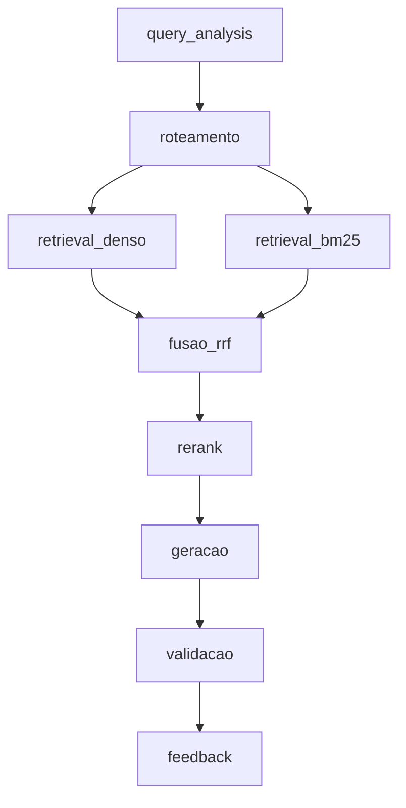

# RAG — Grande Desafio · Cenário 1: Contratações Públicas do RJ

**Residência TIC em Trilhas · PUC-Rio · Instituto ECOA**

Sistema de **Adaptive RAG** sobre contratações públicas do Estado do Rio de Janeiro: dado uma pergunta em linguagem natural, o sistema decide sozinho **onde buscar** (norma, registro estruturado, conversa ou número agregado) antes de buscar, recupera evidência híbrida (densa + BM25 + RRF + rerank) e gera uma resposta citando fontes — ou recusa, quando o caso exige.

## Por que este cenário

Todo órgão público brasileiro publica suas contratações no [PNCP](https://pncp.gov.br) por força da Lei 14.133/2021, mas o portal só permite consulta contrato a contrato — não permite cruzar edital, contrato, ata de registro de preços e valores homologados numa única pergunta. Este projeto constrói essa camada de consulta.

Escolhemos o Cenário 1 por ser o **mais verificável** dos três disponíveis (qualquer resposta pode ser conferida diretamente no portal do PNCP) e por oferecer o melhor contraste entre busca esparsa e densa: número de contrato e CNPJ só aparecem com BM25; "compra de equipamento hospitalar" só aparece com embeddings.

Contexto completo do desafio, dos outros dois cenários e dos padrões de engenharia exigidos está em [GRANDE_DESAFIO_CENARIOS.md](GRANDE_DESAFIO_CENARIOS.md).

## As bases de conhecimento

O desafio pede **quatro bases** de naturezas diferentes (normativa, estruturada, conversacional, agregada). O manifesto atual declara as duas primeiras; conversacional e agregada ainda estão pendentes.

| Base | Natureza | Conteúdo | Fonte | Acesso |
| --- | --- | --- | --- | --- |
| `contratos_estruturado` | Estruturada | Contratos PNCP, filtrados por UF=RJ, recorte trimestral | PNCP — API de consulta v1/v3 (`/v1/contratos`) | REST paginado |
| `editais_normativo` | Normativa | Editais e legislação de licitação | *(URLs placeholder — fontes reais ainda a definir)* | PDF/HTML por URL |
| `atas_conversacional` | Conversacional | Atas de registro de preço, e-mails de compras | — | **Pendente** |
| `pca_agregado` | Agregada | Plano de Contratações Anual, valores homologados | PNCP | **Pendente** |

A definição declarativa de cada base — fonte, tipo de acesso, volume-alvo, campo de vigência, licença — vive em [corpus_manifest.yaml](corpus_manifest.yaml), que é a fonte única de verdade sobre o que entra no corpus. `data/raw/` guarda versões imutáveis por coleta (`v1/`, `v2/`, ...); nenhuma versão é sobrescrita, e uma nova coleta sempre soma uma versão.

> A API do PNCP **não tem busca textual**. Filtro por objeto é feito localmente, e o recorte de dados é sempre determinístico (mesmo manifesto ⇒ mesmo corpus).

## Roteamento adaptativo — a ideia central

A pergunta que o roteador responde não é "sobre o que o usuário falou", e sim "que tipo de evidência responde isso". Três perguntas quase idênticas em vocabulário podem exigir três rotas distintas:

- *"Qual foi o valor médio por quilo de arroz contratado por municípios do RJ em 2025?"* → agregada + estruturada.
- *"Quais contratos de licenciamento de software foram assinados acima de R$ 500 mil em 2025?"* → estruturada, com filtro numérico extraído da pergunta.
- *"Sou MEI, posso participar de pregão eletrônico? Tem algum aberto pra material de escritório?"* → normativa (tratamento a ME/EPP) **e** estruturada (contratações em aberto) na mesma pergunta.

As personas de referência, com as nove perguntas classificadas por rota esperada e tipo, estão em [PERSONAS.md](PERSONAS.md).

## Política de sensibilidade

Classificação feita na **ingestão** (metadado `sensitivity` em cada chunk), nunca delegada ao LLM na hora de responder:

- **Responder:** valores de contrato, nome de empresa fornecedora, CNPJ de pessoa jurídica, objeto contratado — público por lei.
- **Mascarar:** CPF de pessoa física contratada, telefone e e-mail pessoal de servidor que aparecem em atas.
- **Recusar:** dados bancários de fornecedor, credenciais vazadas em e-mail, juízo sobre a legalidade de um contrato específico (o sistema apresenta dados, não acusa). Ver `RefusalReason` em [src/schema.py](src/schema.py).

## Pipeline



Estágios (mesmos nomes usados no campo `stage` do log estruturado): `query_analysis`, `roteamento`, `retrieval_denso`, `retrieval_bm25`, `fusao_rrf`, `rerank`, `geracao`, `validacao`, `feedback`. Detalhes de decisão e divisão de responsabilidades em [ARQUITETURA.md](ARQUITETURA.md).

## Estrutura do repositório

```
├── acompanhamento/              ← relato individual + resumo do dia, a cada encontro
├── data/
│   ├── raw/vN/                  ← versão imutável de cada coleta (staging em raw/.staging/ até promoção)
│   ├── inventory/                ← inventário por versão (JSON), checkpoints e diffs entre versões
│   ├── runs/                    ← relatórios do CLI legado de coleta (--quantidade)
│   ├── config/                  ← dados de apoio ao manifesto (ex.: cnpjs_rj.json)
│   └── CORPUS_INVENTORY.md      ← inventário legível da versão mais recente
├── testes/test-fontes/          ← verificação de disponibilidade das fontes e downloader compartilhado
├── testes/teste_extração.py     ← valida offline o contrato do fetch_corpus (manifesto, CLI, inventário)
├── tests/                       ← testes de contrato (pytest), offline
├── src/
│   ├── fetch_corpus.py          ← coleta determinística e versionada do corpus
│   ├── ingest.py                ← normalização de brutos em chunks (JSONL)
│   └── schema.py                ← modelos Pydantic (chunk, roteamento, resposta, recusa)
├── llm_ecoa.py                  ← exemplo mínimo de geração e embedding via endpoint compartilhado
├── corpus_manifest.yaml         ← o que entra no corpus (fonte única de verdade)
├── ARQUITETURA.md               ← pipeline, estágios e divisão de responsabilidades
├── PERSONAS.md                  ← personas e perguntas de referência
└── .env.example                 ← variáveis necessárias, sem valores reais
```

## Como rodar

**1. Configurar ambiente**

```bash
python -m venv .venv
.venv\Scripts\activate          # Windows
pip install -r requirements.txt
copy .env.example .env          # preencher se necessário; os defaults já apontam para o endpoint da turma
```

**2. Coletar o corpus** (grava em `data/raw/vN/`, versão imutável por execução)

```bash
python -m src.fetch_corpus fetch      --manifest corpus_manifest.yaml   # nova versão a partir do manifesto
python -m src.fetch_corpus update     --manifest corpus_manifest.yaml   # nova versão + diff com a anterior
python -m src.fetch_corpus inventory  --version v1                     # reconstrói/valida o inventário de uma versão
```

**3. Normalizar em chunks** (lê `data/raw/v1`, grava `data/normalized/documents.jsonl`)

```bash
py .\src\ingest.py
py .\src\ingest.py --dry-run    # só conta documentos/chunks, sem gravar
```

**4. Testar o endpoint de LLM/embeddings compartilhado**

```bash
python llm_ecoa.py
```

**5. Rodar os testes**

```bash
pytest tests/ -m "not llm"      # camadas unitária e de contrato, offline
```

### Endpoint de modelos (compartilhado com toda a turma)

```python
OLLAMA_URL       = "http://ecoa-llm.duckdns.org:11434/v1"
GENERATION_MODEL = "qcwind/qwen3-8b-instruct-Q4-K-M"
EMBEDDING_MODEL  = "xagi/qwen3-embedding:0.6b-q4_k_m"
```

Como o endpoint é compartilhado por toda a turma: cache de embeddings em disco é obrigatório, índices devem ser persistidos e recarregados (nunca reindexados a cada execução), e lotes devem ser pequenos com pausa entre chamadas.

Acompanhamento detalhado dia a dia em [acompanhamento/ACOMPANHAMENTO.md](acompanhamento/ACOMPANHAMENTO.md).

---

*TIC em Trilhas · PUC-Rio · Instituto ECOA · MCTI Futuro · Softex*
