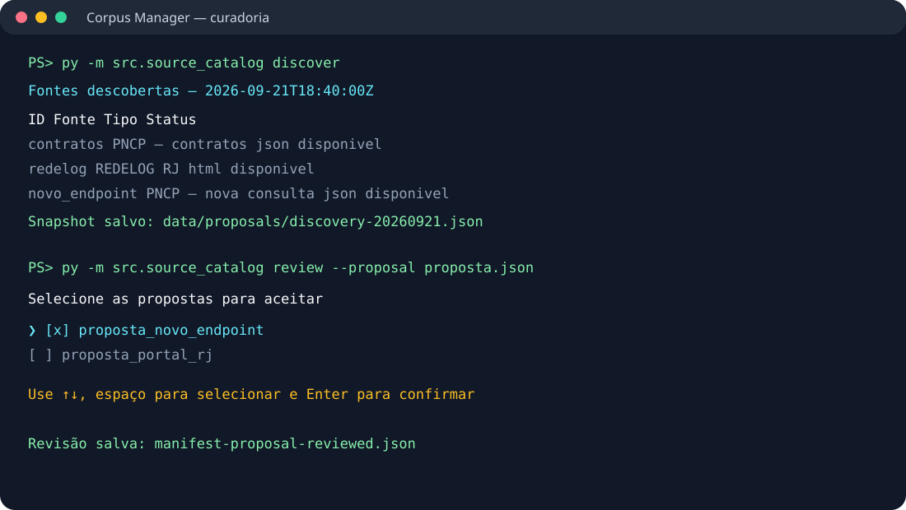
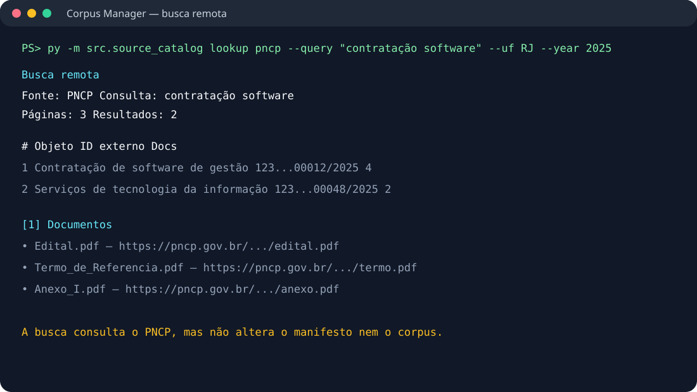
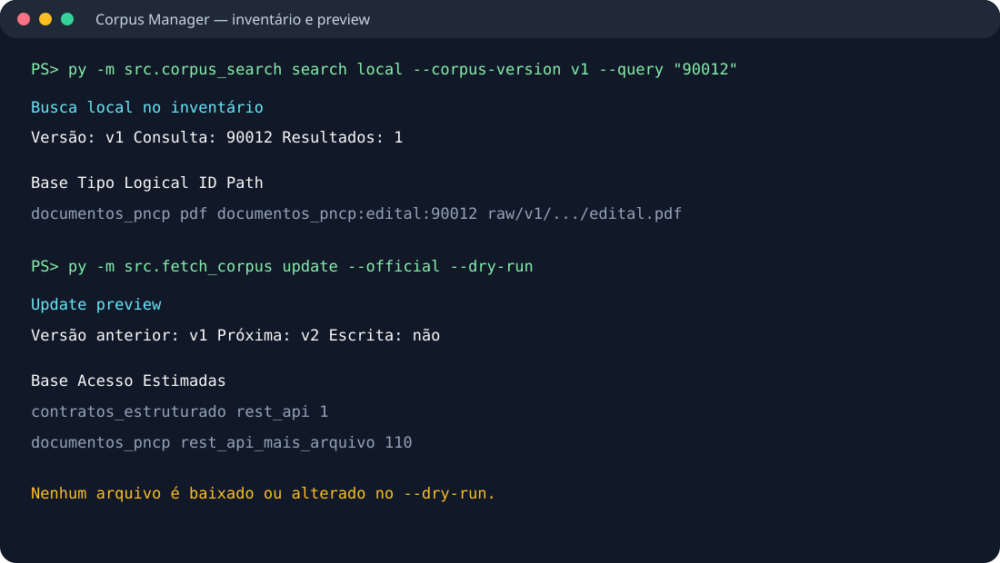
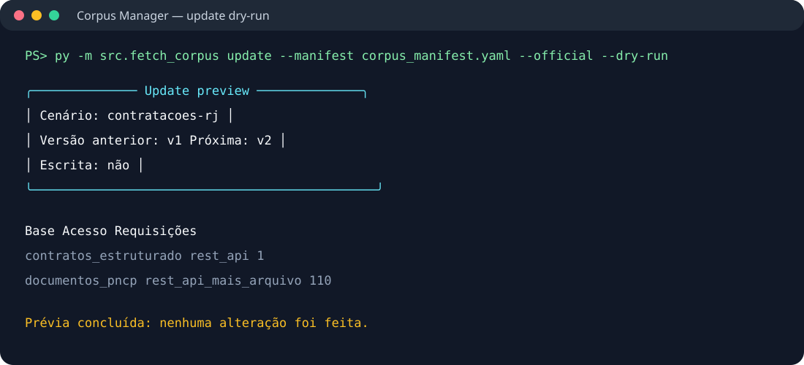

# Interface de linha de comando

Este documento mostra como o professor ou outro integrante pode testar a
extração, consultar fontes suportadas e revisar alterações no manifesto.

## Preparação

Na raiz do projeto:

```powershell
python -m pip install -r requirements.txt
```

A interface é executada no terminal. Typer organiza os comandos, Rich exibe
tabelas e painéis, e InquirerPy fornece a seleção interativa no comando de
revisão.

## 1. Curadoria de fontes

Descubra fontes sem alterar o manifesto:

```powershell
py -m src.source_catalog discover
```

Gere uma proposta:

```powershell
py -m src.source_catalog propose `
  --manifest corpus_manifest.yaml `
  --discovery data/proposals/discovery-AAAA.json
```

Confira o diff:

```powershell
py -m src.source_catalog manifest-diff `
  --manifest corpus_manifest.yaml `
  --proposal data/proposals/manifest-proposal-AAAA.json
```

Revise com setas, espaço e Enter:

```powershell
py -m src.source_catalog review `
  --proposal data/proposals/manifest-proposal-AAAA.json
```

Somente depois aplique a proposta:

```powershell
py -m src.source_catalog apply `
  --manifest corpus_manifest.yaml `
  --proposal data/proposals/manifest-proposal-AAAA-reviewed.json `
  --new-version 2026-09-21
```



O `apply` valida o `manifest_hash` da proposta. Se o manifesto tiver mudado
desde a descoberta, a aplicação é recusada para evitar alterações obsoletas.

## 2. Busca remota no PNCP

A busca remota consulta o PNCP dentro de um recorte determinístico e lista os
documentos associados:

```powershell
py -m src.source_catalog lookup pncp `
  --query "contratação software" `
  --uf RJ `
  --year 2025 `
  --max-pages 5 `
  --max-results 20
```

Essa busca não altera o manifesto nem baixa arquivos para o corpus oficial.
Ela retorna identificadores, metadados e URLs para uma decisão posterior.



## 3. Busca local no inventário

A busca local consulta os metadados de uma versão já registrada:

```powershell
py -m src.corpus_search search local `
  --corpus-version v1 `
  --query "edital 90012" `
  --base-id documentos_pncp
```

Ela pesquisa `logical_id`, `base_id`, caminho, origem, tipo e SHA-256. Ainda
não pesquisa o texto interno dos PDFs.



## 4. Prévia de atualização

Antes de fazer requisições ou criar uma nova versão:

```powershell
py -m src.fetch_corpus update `
  --manifest corpus_manifest.yaml `
  --official `
  --dry-run
```

O preview mostra a versão anterior, a próxima versão, as bases e uma
estimativa de requisições. Nenhum arquivo é alterado.



## 5. Coleta oficial

Depois da revisão:

```powershell
py -m src.fetch_corpus update `
  --manifest corpus_manifest.yaml `
  --official
```

O resultado é uma nova versão imutável em `data/raw/`, acompanhada por
inventário, diff e log. A pasta `data/raw/` continua fora do Git; o manifesto,
os inventários e esta documentação são os artefatos reproduzíveis do projeto.
